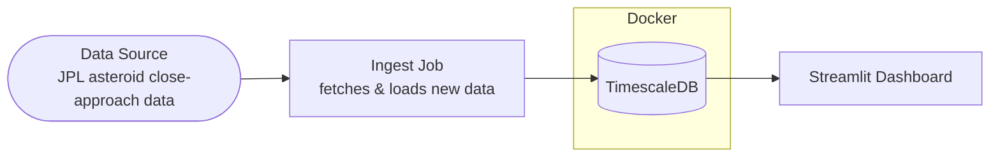

# Telemetry Project - Data Tribe

Open-source telemetry project that ingests, processes, and analyzes mission
telemetry data in real-time using publicly available NASA flight data.

**What it provides:**
- Real-time ingestion and processing of telemetry streams
- Storage and analysis of the data
- Dashboard for real-time monitoring and visualization

## MVP

Working end-to-end data pipeline:

**Source → processing → storage → Dashboard**

## Architecture Diagram



**Data Source:** [JPL Close-Approach Data (CAD) API](https://ssd-api.jpl.nasa.gov/doc/cad.html)
- a free, public NASA/JPL API listing upcoming and past close approaches of
asteroids and comets to Earth. It's the only place data comes from; this
project doesn't generate or modify it, only reads it.

This is currently the project's **only data source**. JPL publishes several
other datasets under the same API family (e.g. impact risk, fireball events)
that could be added later, each as its own ingest job + dashboard page - see
"Adding another data source" below.

Everything downstream of the source (ingest job, database, dashboard) is part
of this project. Only the databases run in Docker today - see "What runs
where" below.

## What runs where

- **In Docker:** `timescaledb` (via `docker-compose.yml`), on host port
  **5433** (not 5432 - see `.env.example`; a native Postgres install commonly
  already owns 5432) - plus `timescaledb_test`, an ephemeral database only
  used by the `pipelines` test suite (see "Tests" below), on port 5434.
- **Not in Docker (run natively via `uv run`):** the ingest job
  (`pipelines.ingest.jpl_cad`), the Streamlit dashboard, and the test suite.
  `pipelines` and `streamlit_dashboard` both have `Dockerfile`s in their
  package folders, but those are for a future containerized deployment - the
  local dev workflow below runs them directly on your machine, talking to
  the Dockerized database over `localhost:5433`.

## Run locally

```
docker compose up -d timescaledb
uv run --package pipelines python -m pipelines.ingest.jpl_cad
uv run --package streamlit_dashboard streamlit run packages/streamlit_dashboard/src/streamlit_dashboard/app.py
```

Then open http://localhost:8501.

Configure via the `DATABASE_URL` environment variable (see `.env.example`).

## Checking the ingested data

The data lives in the `close_approaches` table inside the `timescaledb`
container. Query it directly with `psql` via Docker - no local client needed:

```
docker compose exec timescaledb psql -U telemetry -d telemetry -c "SELECT count(*) FROM close_approaches;"

docker compose exec timescaledb psql -U telemetry -d telemetry -c "SELECT des, close_approach_time, dist_au, v_rel_kms FROM close_approaches ORDER BY close_approach_time LIMIT 10;"
```

Or connect with any Postgres GUI client (DBeaver, TablePlus, pgAdmin, the
VS Code PostgreSQL extension, etc.):

```
host: localhost
port: 5433
database: telemetry
user: telemetry
password: telemetry
```

## Tests

Unit tests exist for `packages/pipelines` (the JPL CAD ingest job), in
`packages/pipelines/tests/`. Most tests need nothing extra; a few - marked
`@pytest.mark.integration` - need a real database and skip automatically
(with a message explaining why) if one isn't reachable.

```
docker compose up -d timescaledb_test
uv run --package pipelines pytest
```

`timescaledb_test` is a separate, ephemeral database from the dev
`timescaledb` service above (different port, different database name, no
persistent volume) - tests never touch your dev data. Configure the test
database via `TEST_DATABASE_URL` (see `.env.example`).

No other package has test coverage yet.

## Adding another data source

The dashboard is structured as one Streamlit page per JPL data source
(`packages/streamlit_dashboard/src/streamlit_dashboard/`):

- `data/` - one query module per source (e.g. `data/close_approaches.py`),
  plus the shared `data/engine.py` (`get_engine()`, cached with
  `st.cache_resource`)
- `pages/` - one page per source, wired into the sidebar nav via
  `st.Page(...)` in `app.py`

To add a new source: add its ingest job under
`packages/pipelines/src/pipelines/ingest/`, a matching `data/<source>.py`
query module, a `pages/<source>.py` page, and register the page in the
`pages` list in `app.py`.