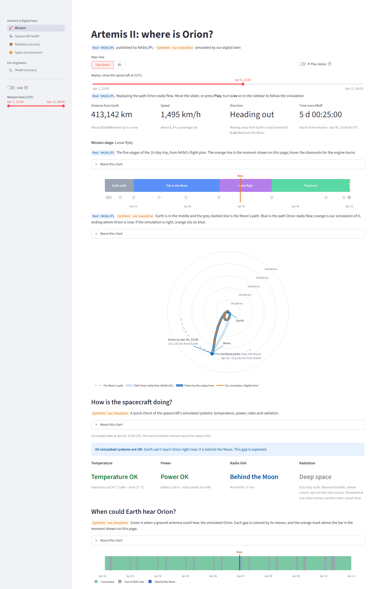
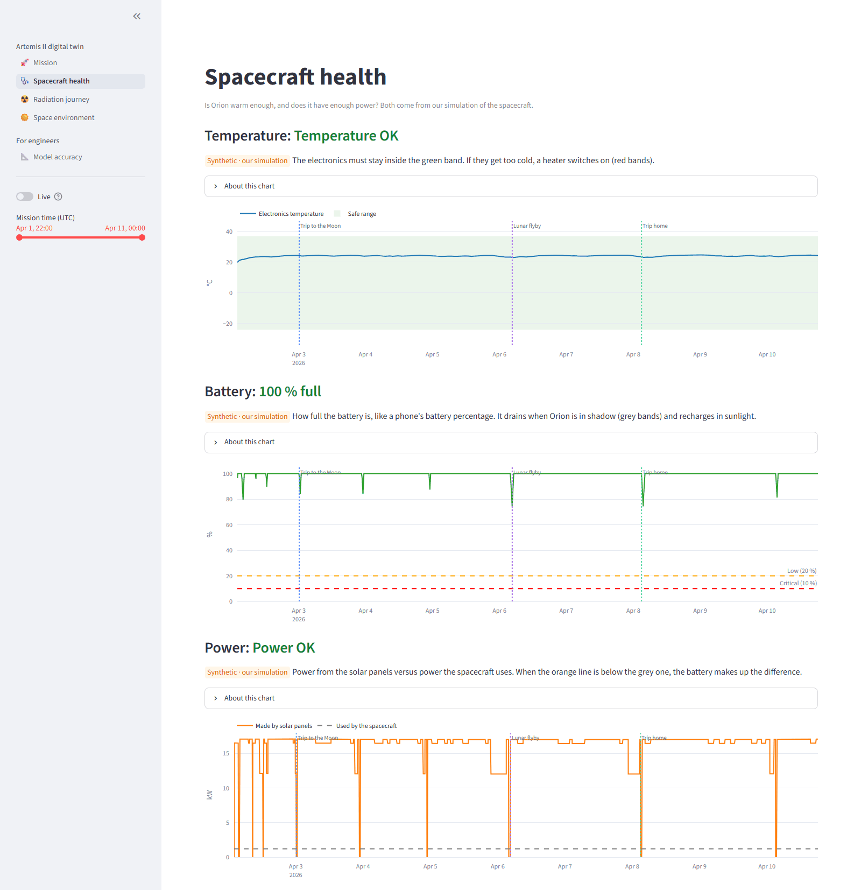
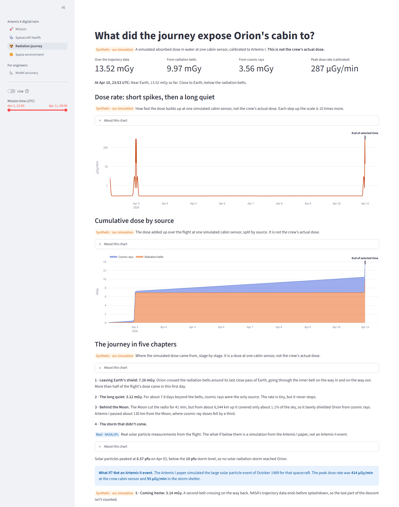
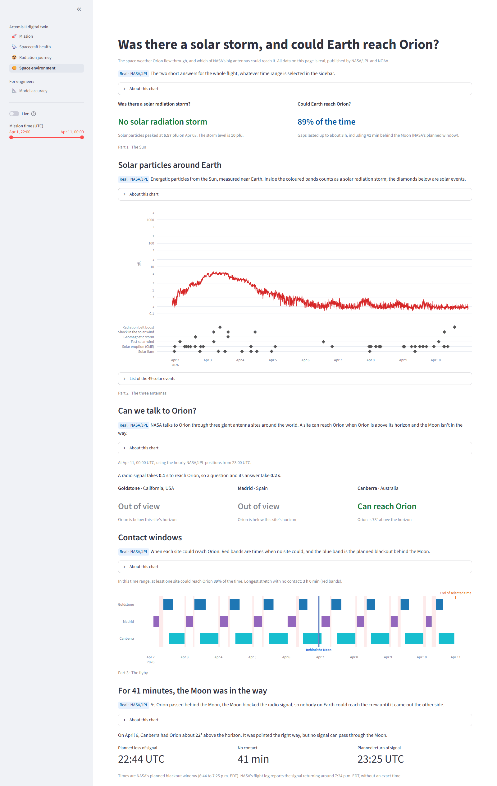
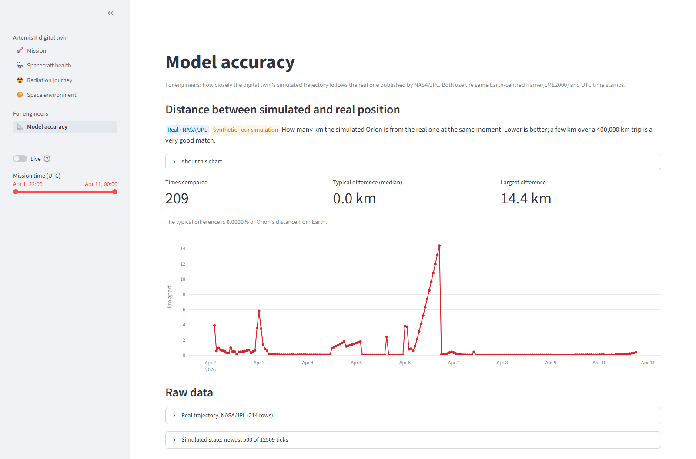
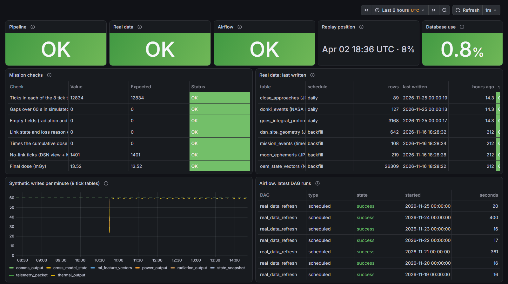
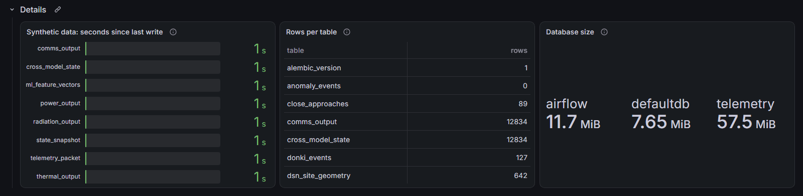
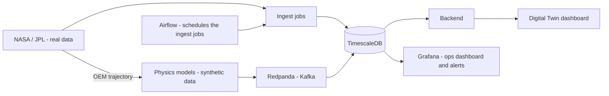

# Telemetry Project - Data Tribe

A **digital twin of NASA's Artemis II / Orion spacecraft**, built from publicly available
NASA/JPL data. Physics models simulate the spacecraft's telemetry (**synthetic data**), and
it is checked against what NASA/JPL publish (**real data**). Everything is shown on one
dashboard, and a public demo is monitored with Grafana.

## Screenshots

Taken from the public demo. Each chart on the dashboard carries a badge: **Real** (NASA/JPL),
**Synthetic** (our simulation) or **Placeholder** (not simulated yet).

**Mission**: where Orion is on its way around the Moon, the flight's stages, and whether
its systems are OK. Real trajectory (blue) and simulated (orange).



**Spacecraft health** (synthetic): electronics temperature and heater, battery charge, solar
power against load, with Earth's and the Moon's shadow shaded.



**Radiation journey** (synthetic, with real GOES particle data): the simulated dose at one
cabin sensor through the radiation belts and deep space.



**Space environment** (real): solar particles and events during the flight, which antenna
site could reach Orion, and the radio blackout behind the Moon.



**Model accuracy** (real vs synthetic, for engineers): how far the simulated Orion is from
the real one.



**Grafana "Telemetry ops"**: the private operations dashboard behind the demo. A status row
for the pipeline, real data, Airflow, replay position and database, then checks on the
stored mission data. Its alerts email when something breaks.





## Architecture



- **Real data:** batch ingest jobs (`packages/pipelines`, scheduled by Airflow) fetch NASA/JPL
  data into TimescaleDB.
- **Synthetic data:** the simulator (`packages/physics_models`) replays the flight at 1 tick
  per second. It follows NASA's trajectory and computes thermal, power, comms and radiation.
  It publishes to Kafka (Redpanda), and a consumer writes the result to the same database.
- **Serving:** a FastAPI backend (`packages/backend`) serves both kinds of data to the
  Streamlit dashboard (`dashboard/`). Data contracts (`packages/contracts`) define every
  field.

The details are in [`docs/ARCHITECTURE.md`](docs/ARCHITECTURE.md).

## Quick start

Needs Docker. Run from the repo root.

```bash
# 1. Setup (once): set POSTGRES_USER / POSTGRES_PASSWORD / POSTGRES_DB in .env
cp .env.example .env

# 2. Everything in Docker, plus Airflow for the real data
docker compose --profile airflow up -d --build

# 3. Load the real data (once; Airflow then refreshes it daily). If it says the DAG
#    is not found, Airflow is still loading it: retry after a few seconds.
docker compose exec airflow-scheduler airflow dags trigger real_data_backfill

# 4. Open the dashboard: http://localhost:8501
```

| Service | URL |
|---------|-----|
| Digital Twin dashboard | http://localhost:8501 |
| Backend API (docs) | http://localhost:8000/docs |
| Airflow (user `admin`, password `AIRFLOW_ADMIN_PASSWORD`, default `admin`) | http://localhost:8080 |
| TimescaleDB | `localhost:5433` (not 5432, which a native Postgres often owns) |

The simulated Orion only starts moving where NASA's trajectory data begins, about 3.4 hours
after liftoff. To watch the whole flight in about 3.5 hours:
`PHYSICS_MODELS_START_MET_SECONDS=12300 PHYSICS_MODELS_TIME_SCALE=60 docker compose up -d`.

Without Airflow, `docker compose up -d --build` starts the rest, and the ingest jobs
can be run by hand. [`RUN_SERVICES.md`](RUN_SERVICES.md) covers that, running the
backend or dashboard natively, the replay speed controls, stopping and
troubleshooting. Running it on a public server: [`docs/guides/UPCLOUD_DEPLOYMENT.md`](docs/guides/UPCLOUD_DEPLOYMENT.md).

## Real data vs synthetic data

Orion's onboard telemetry is not public, so this project **simulates it**: that is
the **synthetic data**. The **real data** is what NASA/JPL do publish; it drives the
simulation and is the ground truth to check it against.

| Data | Kind | Role |
|------|------|------|
| NASA OEM trajectory, mission timeline (draft) | Real | Input: the simulated Orion follows them |
| JPL Horizons Orion trajectory | Real | Ground truth for the simulated trajectory |
| Moon, DSN antennas, space weather (GOES, DONKI) | Real | Context, shown next to the simulation |
| State, thermal, power | Synthetic | Physics model output |
| Comms | Synthetic | S-band link budget to the Deep Space Network, including the blackout behind the Moon |
| Radiation | Synthetic | Simulated dose at one cabin sensor, calibrated to Artemis I |
| Anomaly/ML | Synthetic | **Placeholder** values, not simulated yet |

### The dashboard

One Streamlit app, the **Digital Twin dashboard** (`dashboard/src/prototype/`), shows
both kinds of data:

| Page | Shows |
|------|-------|
| Mission | Where Orion is: real vs simulated trajectory with the Moon, mission timeline, replay, system status, radio link |
| Spacecraft health | Simulated temperature, battery and power |
| Radiation journey | Simulated cabin dose by source and mission stage, with the real solar particle data |
| Space environment | Real solar particles (GOES), solar events (DONKI) and DSN antenna contact, including signal delay and the lunar blackout |
| Model accuracy (for engineers) | Distance between the simulated and the real trajectory, plus the raw data |

## Status and known limits

Built from October to December 2026. What works: the whole path end to end, from NASA/JPL
data and the simulation to the database, API, dashboard and a monitored public demo. Known
limits:

- **Anomaly detection and ML features** are placeholders: the topics, tables and API routes
  exist, but nothing is detected or learned.
- **The mission timeline is a draft**: it was extracted from NASA's timeline PDF but not
  checked against it row by row. It drives the planned attitude and the dashboard's
  mission stages.
- **Simplified physics:** attitude is not simulated (roll, pitch and yaw are 0), the
  spacecraft load is a fixed 1,200 W, the comms link only uses the Deep Space Network (the
  real Orion also used the Near Space Network close to Earth), and radiation does not
  degrade the other subsystems.
- **Open issues:** two power-contract consistency rules (#73), and value clamps that would
  hide a `NaN` from tick validation (#91).

How each model meets its data contract: [`docs/integration/CONTRACT_COMPLIANCE.md`](docs/integration/CONTRACT_COMPLIANCE.md).

## Checking the data

```bash
docker compose exec timescaledb psql -U telemetry -d telemetry -c "\dt"
docker compose exec timescaledb psql -U telemetry -d telemetry -c "SELECT count(*) FROM orion_ephemeris;"
curl "http://localhost:8000/orion?limit=5"
docker compose exec airflow-scheduler airflow dags list-runs real_data_backfill
```

Replace `telemetry` with your `POSTGRES_USER` / `POSTGRES_DB` if they differ. In the
Airflow UI, a DAG's **Grid** view shows each source's run and its **Logs**.

## Tests

```bash
uv sync --all-packages                          # once, needs uv
uv run pytest tests/unit                        # natively
docker compose run --rm tests                   # or in Docker
docker compose run --rm --build airflow-tests   # Airflow DAG tests (need Airflow, skipped natively)
```

Tests live in `tests/`, mirroring the source path: `tests/unit/<package>/<module
path>/test_<function>.py`, no network or database (HTTP mocked with `responses`).
If test collection fails with `ModuleNotFoundError`, run `uv sync --all-packages`.
CI runs ruff and the unit tests on every pull request.

## Adding another data source

A real data source flows ingest -> TimescaleDB -> backend -> dashboard:

1. **Ingest:** a self-contained module `packages/pipelines/src/pipelines/ingest/<source>.py`
   that owns its table (follow `jpl_cad.py`: schema DDL, hypertable, dataclass,
   `fetch_*` / `upsert_*` / `main()`).
2. **Airflow:** add the module to `BACKFILL_SOURCES` in
   `airflow/dags/real_data_sources.py` (and to `REFRESH_SOURCES` if its data still
   changes); a unit test fails until every ingest module is listed.
3. **Backend:** a response model in `packages/contracts/src/contracts/models.py`, an ORM
   model in `packages/backend/src/backend/models.py`, and a route in
   `packages/backend/src/backend/api/routes/<source>.py` registered in
   `backend/api/__init__.py`.
4. **Dashboard:** a client method in `dashboard/src/prototype/data/backend_api.py`, a
   cached loader in `views/_data.py`, the chart on a page, and its badge / summary /
   explainer entries in `views/_explain.py` (a unit test keeps those in sync).
5. **Tests:** unit tests under `tests/unit/pipelines/ingest/<source>/` and
   `tests/unit/backend/`.

## More docs

| Doc | For |
|-----|-----|
| [`docs/README.md`](docs/README.md) | The documentation index: start here |
| [`docs/ARCHITECTURE.md`](docs/ARCHITECTURE.md) | How the parts fit together |
| [`RUN_SERVICES.md`](RUN_SERVICES.md) | Start-up order, replay controls, native runs, troubleshooting |
| [`docs/architecture/PHYSICS_MODELS.md`](docs/architecture/PHYSICS_MODELS.md) | The simulator and its models |
| [`docs/architecture/DASHBOARD.md`](docs/architecture/DASHBOARD.md) | The dashboard's design |
| [`docs/guides/UPCLOUD_DEPLOYMENT.md`](docs/guides/UPCLOUD_DEPLOYMENT.md), [`docs/guides/MONITORING.md`](docs/guides/MONITORING.md) | The public server and its monitoring |
| `packages/*/README.md`, `dashboard/README.md`, `airflow/README.md`, `infra/README.md` | Each part: what it is, how to run and test it |
