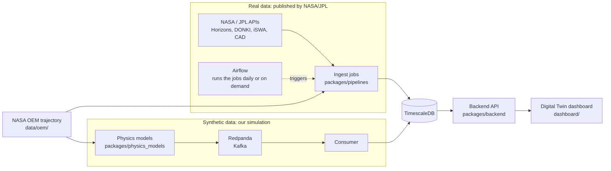

# Telemetry Project - Data Tribe

Open-source project building a **digital twin of NASA's Artemis II / Orion
spacecraft** from publicly available NASA/JPL data: physics models simulate
the spacecraft's telemetry (**synthetic data**), checked against what NASA/JPL
publish (**real data**).

## Architecture



Both paths end in the same database. The dashboard reads it only through the backend
API. NASA's OEM trajectory feeds both sides: it is stored as real data and it is the
path the simulated Orion flies.

## Quick start

Needs Docker. Run from the repo root.

```bash
# 1. Setup (once): set POSTGRES_USER / POSTGRES_PASSWORD / POSTGRES_DB in .env
cp .env.example .env

# 2. Everything in Docker, plus Airflow for the real data
docker compose --profile airflow up -d --build

# 3. Load the real data (once; Airflow then refreshes it daily). If it says the DAG
#    is not found, Airflow is still loading it: retry after a few seconds.
docker compose exec airflow-scheduler airflow dags trigger real_data_backfill

# 4. Open the dashboard: http://localhost:8501
```

| Service | URL |
|---------|-----|
| Digital Twin dashboard | http://localhost:8501 |
| Backend API (docs) | http://localhost:8000/docs |
| Airflow (user `admin`, password `AIRFLOW_ADMIN_PASSWORD`, default `admin`) | http://localhost:8080 |
| TimescaleDB | `localhost:5433` (not 5432, which a native Postgres often owns) |

Without Airflow, `docker compose up -d --build` starts the rest, and the ingest jobs
can be run by hand. [`RUN_SERVICES.md`](RUN_SERVICES.md) covers that, running the
backend or dashboard natively, the replay speed controls, stopping and
troubleshooting.

## Real data vs synthetic data

Orion's onboard telemetry (temperatures, battery charge, link margin, radiation
dose, ...) is not public. So this project **simulates it from physics** - that is
the **synthetic data** - and uses the **real data** NASA/JPL do publish in two
ways: as **inputs** that drive the simulation, and as **ground truth** to check it
against.

- **Real data** - published by NASA/JPL: Orion's trajectory, the Moon's position,
  Deep Space Network (DSN) geometry, space weather, and the planned mission
  timeline. Fetched by batch ingest jobs (`packages/pipelines`) into TimescaleDB,
  or read from NASA files shipped in the repo (`data/oem/`).
- **Synthetic data** - simulated spacecraft telemetry from the physics models
  (`packages/physics_models`), streamed through Redpanda (Kafka) into TimescaleDB.
  State, thermal and power are real physics models; comms, radiation, packet
  assembly and anomaly/ML still emit **placeholder values**.

| Data | Kind | Stored in | Drives the simulation? | Shown in |
|------|------|-----------|------------------------|----------|
| NASA OEM trajectory arcs | real (file) | `data/oem/`, `oem_state_vectors` | ✅ the synthetic trajectory is interpolated from these | Mission |
| Artemis II attitude timeline | real (curated, **draft**) | `contracts.planned_attitude`, `mission_events` | ✅ spacecraft attitude / solar angles | Mission (timeline strip), Spacecraft health (phase markers) |
| JPL Horizons Orion trajectory | real | `orion_ephemeris` | no - ground truth the synthetic trajectory is compared against | Mission, Model accuracy |
| JPL Horizons Moon position | real | `moon_ephemeris` | no - context on the trajectory map | Mission |
| DSN site geometry (Horizons) | real | `dsn_site_geometry` | not yet (planned input for comms) | Space environment |
| GOES proton flux (iSWA) | real | `goes_integral_protons` | not yet (planned input for radiation) | Space environment |
| DONKI space weather events | real | `donki_events` | not yet (planned input for radiation) | Space environment |
| JPL close approaches (CAD) | real | `close_approaches` | no | not shown (API only: `/close-approaches`) |
| State, thermal, power | synthetic | `state_snapshot`, `thermal_output`, `power_output` | - (model outputs) | Mission, Spacecraft health |
| Comms, radiation, packet, cross-model, ML features | synthetic, **placeholder** | `comms_output`, `radiation_output`, `telemetry_packet`, `cross_model_state`, `ml_feature_vectors` | - (model outputs) | Mission (grey "not simulated yet" tiles) |

Each real table is filled by the ingest module of the same source in
`packages/pipelines/src/pipelines/ingest/` (e.g. `jpl_orion` -> `orion_ephemeris`).

### The dashboard

One Streamlit app, the **Digital Twin dashboard** (`dashboard/src/prototype/`), shows
both kinds of data. Every chart carries a badge saying where its data comes from:
**Real · NASA/JPL**, **Synthetic · our simulation**, or **Placeholder · not simulated
yet**.

| Page | Shows |
|------|-------|
| Mission | Where Orion is: real vs simulated trajectory with the Moon, mission timeline, replay, system status |
| Spacecraft health | Simulated temperature, battery and power |
| Space environment | Real solar particles (GOES), solar events (DONKI) and DSN antenna contact, incl. signal delay |
| Model accuracy (for engineers) | Distance between the simulated and the real trajectory, plus the raw data |

## Checking the data

```bash
docker compose exec timescaledb psql -U telemetry -d telemetry -c "\dt"
docker compose exec timescaledb psql -U telemetry -d telemetry -c "SELECT count(*) FROM orion_ephemeris;"
curl "http://localhost:8000/orion?limit=5"
docker compose exec airflow-scheduler airflow dags list-runs real_data_backfill
```

Replace `telemetry` with your `POSTGRES_USER` / `POSTGRES_DB` if they differ. In the
Airflow UI, a DAG's **Grid** view shows each source's run and its **Logs**.

## Tests

```bash
uv sync --all-packages                          # once, needs uv
uv run pytest tests/unit                        # natively
docker compose run --rm tests                   # or in Docker
docker compose run --rm --build airflow-tests   # Airflow DAG tests (need Airflow, skipped natively)
```

Tests live in `tests/`, mirroring the source path: `tests/unit/<package>/<module
path>/test_<function>.py`, no network or database (HTTP mocked with `responses`).
If test collection fails with `ModuleNotFoundError`, run `uv sync --all-packages`.

## Adding another data source

A real data source flows ingest -> TimescaleDB -> backend -> dashboard:

1. **Ingest:** a self-contained module `packages/pipelines/src/pipelines/ingest/<source>.py`
   that owns its table (follow `jpl_cad.py`: schema DDL, hypertable, dataclass,
   `fetch_*` / `upsert_*` / `main()`).
2. **Airflow:** add the module to `BACKFILL_SOURCES` in
   `airflow/dags/real_data_sources.py` (and to `REFRESH_SOURCES` if its data still
   changes); a unit test fails until every ingest module is listed.
3. **Backend:** a response model in `packages/contracts/src/contracts/models.py`, an ORM
   model in `packages/backend/src/backend/models.py`, and a route in
   `packages/backend/src/backend/api/routes/<source>.py` registered in
   `backend/api/__init__.py`.
4. **Dashboard:** a client method in `dashboard/src/prototype/data/backend_api.py`, a
   cached loader in `pages/_data.py`, the chart on a page, and its badge / summary /
   explainer entries in `pages/_explain.py` (a unit test keeps those in sync).
5. **Tests:** unit tests under `tests/unit/pipelines/ingest/<source>/` and
   `tests/unit/backend/`.

## More docs

[`RUN_SERVICES.md`](RUN_SERVICES.md) (startup, replay controls, troubleshooting) ·
[`docs/README.md`](docs/README.md) (documentation index) ·
[`packages/backend/README.md`](packages/backend/README.md) (API reference) ·
[`docs/decisions/ONE_DASHBOARD.md`](docs/decisions/ONE_DASHBOARD.md) (why one dashboard)
