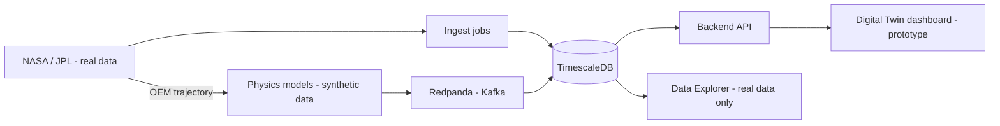

# Telemetry Project - Data Tribe

Open-source project building a **digital twin of NASA's Artemis II / Orion
spacecraft** from publicly available NASA/JPL data: physics models simulate
the spacecraft's telemetry (**synthetic data**), checked against what NASA/JPL
publish (**real data**).

## Architecture



## Quick start: run the prototype

Needs Docker and [`uv`](https://docs.astral.sh/uv/). Run from the repo root;
`.env` needs `POSTGRES_USER`, `POSTGRES_PASSWORD` and `POSTGRES_DB`.

```bash
# 1. Setup (once)
cp .env.example .env
uv sync --all-packages

# 2. Database + Kafka, then the synthetic data tables
docker compose up -d timescaledb redpanda
cd packages/backend
uv run --package backend alembic upgrade head
cd ../..

# 3. Real data shown next to the simulation
uv run --package pipelines python -m pipelines.ingest.jpl_orion
uv run --package pipelines python -m pipelines.ingest.jpl_dsn_geometry
uv run --package pipelines python -m pipelines.ingest.iswa_goes_protons
uv run --package pipelines python -m pipelines.ingest.donki

# 4. Synthetic data: physics models -> Kafka -> TimescaleDB
docker compose up -d --build physics_models physics_models_consumer

# 5. Backend API (terminal 1)
uv run --package backend python -m backend.main

# 6. Prototype dashboard (terminal 2) -> http://localhost:8501
uv run streamlit run dashboard/src/prototype/app.py
```

To speed up the simulated mission, see "Demo Replay Controls" in
[`RUN_SERVICES.md`](RUN_SERVICES.md); it also covers stopping services and
troubleshooting. Running only the Data Explorer is under [How to run](#how-to-run).

## Real data vs synthetic data

Orion's onboard telemetry (temperatures, battery charge, link margin, radiation
dose, ...) is not public. So this project **simulates it from physics** - that is
the **synthetic data** - and uses the **real data** NASA/JPL do publish in two
ways: as **inputs** that drive the simulation, and as **ground truth** to check it
against.

- **Real data** - published by NASA/JPL: Orion's trajectory, Deep Space Network
  (DSN) geometry, space weather, asteroid close approaches, and the planned mission
  timeline. Fetched by batch ingest jobs (`packages/pipelines`) into TimescaleDB,
  or read from NASA files shipped in the repo (`data/oem/`).
- **Synthetic data** - simulated spacecraft telemetry from the physics models
  (`packages/physics_models`), streamed through Redpanda (Kafka) into TimescaleDB.
  State, thermal and power are real physics models; comms, radiation, packet
  assembly and anomaly/ML still emit **placeholder values**.

| Data | Kind | Stored in | Drives the simulation? | Shown in |
|------|------|-----------|------------------------|----------|
| NASA OEM trajectory arcs | real (file) | `data/oem/`, `oem_state_vectors` | ✅ the synthetic trajectory is interpolated from these | Digital Twin: Trajectory |
| Artemis II attitude timeline | real (curated, **draft**) | `contracts.planned_attitude`, `mission_events` | ✅ spacecraft attitude / solar angles | - |
| JPL Horizons Orion trajectory | real | `orion_ephemeris` | no - ground truth the synthetic trajectory is compared against | Data Explorer, Digital Twin: Trajectory |
| DSN site geometry (Horizons) | real | `dsn_site_geometry` | not yet (planned input for comms) | Data Explorer, Digital Twin: DSN Coverage |
| GOES proton flux (iSWA) | real | `goes_integral_protons` | not yet (planned input for radiation) | Data Explorer, Digital Twin: Space Weather |
| DONKI space weather events | real | `donki_events` | not yet (planned input for radiation) | Data Explorer, Digital Twin: Space Weather |
| JPL close approaches (CAD) | real | `close_approaches` | no | Data Explorer |
| State, thermal, power | synthetic | `state_snapshot`, `thermal_output`, `power_output` | - (model outputs) | Digital Twin |
| Comms, radiation, packet, cross-model, ML features | synthetic, **placeholder** | `comms_output`, `radiation_output`, `telemetry_packet`, `cross_model_state`, `ml_feature_vectors` | - (model outputs) | Digital Twin: Overview |

### Two dashboards

| | **Data Explorer** | **Digital Twin dashboard (prototype)** |
|---|---|---|
| Shows | Real data only - one page per source | Synthetic telemetry, with real data alongside for comparison |
| Code | `packages/streamlit_dashboard/` | `dashboard/src/prototype/` (Streamlit v1; a JS "Mission Control" is planned) |
| Reads from | TimescaleDB directly | The backend API (`packages/backend`) |
| Use it to | Check what the ingest jobs collected | Watch the simulated mission and compare it to the real trajectory |

The Data Explorer came first and proved the ingest -> store -> visualize pattern;
it is the first stage of the digital twin, not a separate project.

More docs: [`docs/README.md`](docs/README.md) (index),
[`RUN_SERVICES.md`](RUN_SERVICES.md) (full startup order and troubleshooting),
[`packages/backend/README.md`](packages/backend/README.md) (API reference).

## Data sources

TimescaleDB, Redpanda, `physics_models` and `physics_models_consumer` run in
Docker; everything else runs natively with `uv run`.

**Real data sources** (one ingest module and one table each):

| Source | Ingest module | Table |
|--------|---------------|-------|
| [JPL Close-Approach Data (CAD)](https://ssd-api.jpl.nasa.gov/doc/cad.html) - asteroid/comet close approaches | `jpl_cad` | `close_approaches` |
| [JPL Horizons](https://ssd-api.jpl.nasa.gov/doc/horizons.html) - Artemis II Orion ephemeris | `jpl_orion` | `orion_ephemeris` |
| JPL Horizons - Orion geometry as seen from the DSN sites | `jpl_dsn_geometry` | `dsn_site_geometry` |
| [NASA CCMC DONKI](https://ccmc.gsfc.nasa.gov/DONKI-API/get/) - space weather events (CME, SEP, FLR, GST, HSS, ...) | `donki` | `donki_events` |
| [NASA CCMC iSWA HAPI](https://iswa.gsfc.nasa.gov/IswaSystemWebApp/hapi/) - GOES integral proton flux | `iswa_goes_protons` | `goes_integral_protons` |
| NASA OEM ephemeris arcs (`data/oem/`, no network) | `nasa_oem` | `oem_state_vectors` |
| Artemis II mission timeline (curated, **draft** data, no network) | `mission_events` | `mission_events` |

**Synthetic data tables** (`state_snapshot`, `thermal_output`, `power_output`,
`comms_output`, `radiation_output`, `cross_model_state`, `telemetry_packet`,
`anomaly_events`, `ml_feature_vectors`) are created by the backend's Alembic
migration and filled by `physics_models_consumer`. The backend serves real data
at top-level routes (`/orion`, `/donki`, ...) and synthetic data under
`/telemetry/synthetic/*`.

## What runs where

- **In Docker** (`docker-compose.yml`): `timescaledb` (host port **5433**, not
  5432 - a native Postgres install commonly already owns 5432), `redpanda`
  (Kafka on `:9092`), `physics_models` (producer) and `physics_models_consumer`,
  plus the on-demand `tests` service (see "Tests" below).
- **Natively via `uv run`**: the ingest jobs, the backend API (`:8000`) and the
  two dashboards (`:8501`). They talk to the Dockerized database over
  `localhost:5433`.

## How to run

Prerequisites: Docker (with Compose) and [`uv`](https://docs.astral.sh/uv/).
Run all commands from the **repo root** unless noted.

### 0. One-time setup

```bash
cp .env.example .env        # then set POSTGRES_USER / POSTGRES_PASSWORD / POSTGRES_DB
uv sync --all-packages      # one shared .venv with every workspace package
```

`.env` is read by Docker Compose, the ingest jobs, the backend and the Data
Explorer. `DATABASE_URL` is optional; without it, host-side tools connect to
`localhost:5433` using the three `POSTGRES_*` values.

### Real data path - ingest + Data Explorer

```bash
# 1. Database
docker compose up -d timescaledb

# 2. Ingest the real data (each job creates its own table)
uv run --package pipelines python -m pipelines.ingest.jpl_cad
uv run --package pipelines python -m pipelines.ingest.jpl_orion
uv run --package pipelines python -m pipelines.ingest.jpl_dsn_geometry
uv run --package pipelines python -m pipelines.ingest.donki
uv run --package pipelines python -m pipelines.ingest.iswa_goes_protons
uv run --package pipelines python -m pipelines.ingest.nasa_oem
uv run --package pipelines python -m pipelines.ingest.mission_events

# 3. Data Explorer -> http://localhost:8501
uv run --package streamlit_dashboard streamlit run packages/streamlit_dashboard/src/streamlit_dashboard/app.py
```

Pages: Welcome, Close Approaches, Artemis II Orion, DSN Coverage, NASA DONKI,
GOES Proton Flux.

### Synthetic data path - prototype (Digital Twin dashboard)

See [Quick start: run the prototype](#quick-start-run-the-prototype). Pages:
Overview / Health, Trajectory, Thermal, Power, Space Weather, DSN Coverage.

Both dashboards default to port 8501, so run one at a time or pass
`--server.port 8502` to the second. The backend's interactive API docs are at
http://localhost:8000/docs.

### Ingest options

```bash
uv run --package pipelines python -m pipelines.ingest.jpl_cad --date-min now --date-max +60 --dist-max 0.05 --body Earth
uv run --package pipelines python -m pipelines.ingest.donki --start-date 2026-04-01 --end-date 2026-04-10 --event-type CME --event-type SEP --request-delay 0.2
uv run --package pipelines python -m pipelines.ingest.iswa_goes_protons --start 2026-04-01T00:00:00Z --end 2026-04-12T00:00:00Z
```

Run any ingest module with `--help` for its full option list.

## Checking the data

Query the `timescaledb` container directly - no local `psql` client needed
(replace `telemetry` with your `POSTGRES_USER` / `POSTGRES_DB` if they differ):

```
docker compose exec timescaledb psql -U telemetry -d telemetry -c "\dt"
docker compose exec timescaledb psql -U telemetry -d telemetry -c "SELECT des, close_approach_time, dist_au, v_rel_kms FROM close_approaches ORDER BY close_approach_time LIMIT 10;"
docker compose exec timescaledb psql -U telemetry -d telemetry -c "SELECT count(*) FROM orion_ephemeris;"
docker compose exec timescaledb psql -U telemetry -d telemetry -c "SELECT count(*) FROM dsn_site_geometry;"
docker compose exec timescaledb psql -U telemetry -d telemetry -c "SELECT event_type, count(*) FROM donki_events GROUP BY event_type ORDER BY count DESC;"
docker compose exec timescaledb psql -U telemetry -d telemetry -c "SELECT count(*), min(time), max(time), max(p10_pfu) FROM goes_integral_protons;"
docker compose exec timescaledb psql -U telemetry -d telemetry -c "SELECT count(*) FROM oem_state_vectors;"
docker compose exec timescaledb psql -U telemetry -d telemetry -c "SELECT count(*), max(timestamp_utc) FROM telemetry_packet;"
```

You can also query through the API, e.g. `curl "http://localhost:8000/orion?limit=5"`
or `curl http://localhost:8000/telemetry/synthetic/latest`, or connect any
Postgres GUI client (DBeaver, TablePlus, pgAdmin, ...) to `localhost:5433`.

## Tests

```
tests/
├── unit/
    └── <package>/<module path>/
        ├── conftest.py            # fixtures for that module's tests
        └── test_<function>.py     # one file per function under test
└── integration/
      └── <package>/<module path>/test_<feature>.py
```

Each test file covers one function (e.g.
`tests/unit/pipelines/ingest/jpl_cad/test_fetch_close_approaches.py` tests
`pipelines.ingest.jpl_cad.fetch_close_approaches`), and every test is named
`test_<function>_<expected behavior>`. HTTP calls are mocked with
`responses`, database connections with `unittest.mock.MagicMock`.

Unit tests cover all pipeline ingest modules, the backend (`tests/unit/backend`)
and the physics models (`tests/unit/physics_models`).

```
# in Docker - from the repo root
docker compose run --rm tests

# or natively - also from the repo root
uv sync --all-packages   # ensure the shared root venv has every workspace package
uv run pytest tests/unit
```

The root `uv run pytest` reuses the single shared `.venv`. A partial
`uv sync --package <pkg>` can prune other workspace packages from it, making
imports like `pydantic`/`fastapi` fail at test collection. Run
`uv sync --all-packages` first if you hit `ModuleNotFoundError` in tests.

Live datasource and database checks belong under `tests/integration/` and have
their own datasource-specific runner.

## Adding another data source

The Data Explorer is structured as one Streamlit page per real data source
(`packages/streamlit_dashboard/src/streamlit_dashboard/`):

- `data/` - one query module per source (e.g. `data/close_approaches.py`),
  plus the shared `data/engine.py` (`get_engine()`, cached with
  `st.cache_resource`)
- `pages/` - one page per source, wired into the sidebar nav via
  `st.Page(...)` in `app.py`

To add a new source: add its ingest job under
`packages/pipelines/src/pipelines/ingest/`, a matching `data/<source>.py`
query module, a `pages/<source>.py` page, and register the page in the
`pages` list in `app.py`. Add unit tests for the ingest job under
`tests/unit/pipelines/ingest/<source>/`, following the layout in "Tests" above.
