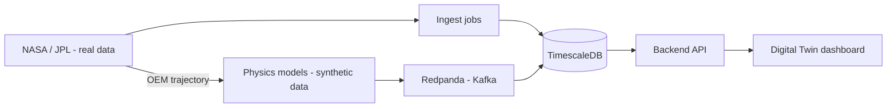

# Telemetry Project - Data Tribe

Open-source project building a **digital twin of NASA's Artemis II / Orion
spacecraft** from publicly available NASA/JPL data: physics models simulate
the spacecraft's telemetry (**synthetic data**), checked against what NASA/JPL
publish (**real data**).

## Architecture



## Quick start: run the dashboard

Needs Docker and [`uv`](https://docs.astral.sh/uv/). Run from the repo root;
`.env` needs `POSTGRES_USER`, `POSTGRES_PASSWORD` and `POSTGRES_DB`.

```bash
# 1. Setup (once)
cp .env.example .env
uv sync --all-packages

# 2. Everything in Docker: database, Kafka, migration, physics models -> Kafka ->
#    TimescaleDB, backend API (:8000) and the Digital Twin dashboard (:8501)
docker compose up -d --build

# 3. Real data shown next to the simulation. Either on the host, one job per source:
uv run --package pipelines python -m pipelines.ingest.nasa_oem
uv run --package pipelines python -m pipelines.ingest.jpl_orion
uv run --package pipelines python -m pipelines.ingest.jpl_moon
uv run --package pipelines python -m pipelines.ingest.jpl_dsn_geometry
uv run --package pipelines python -m pipelines.ingest.iswa_goes_protons
uv run --package pipelines python -m pipelines.ingest.donki
uv run --package pipelines python -m pipelines.ingest.mission_events  # mission phases (draft)
#    ...or all of them through Airflow (UI http://localhost:8080, user admin):
docker compose --profile airflow up -d --build
docker compose exec airflow-scheduler airflow dags trigger real_data_backfill

# 4. Open http://localhost:8501
```

To work on the backend or dashboard code, run them natively with `uv run` instead
(`BACKEND_RELOAD=1` turns on backend auto-reload; see [`RUN_SERVICES.md`](RUN_SERVICES.md)).

To speed up the simulated mission, see "Demo Replay Controls" in
[`RUN_SERVICES.md`](RUN_SERVICES.md); it also covers stopping services and
troubleshooting.

## Real data vs synthetic data

Orion's onboard telemetry (temperatures, battery charge, link margin, radiation
dose, ...) is not public. So this project **simulates it from physics** - that is
the **synthetic data** - and uses the **real data** NASA/JPL do publish in two
ways: as **inputs** that drive the simulation, and as **ground truth** to check it
against.

- **Real data** - published by NASA/JPL: Orion's trajectory, the Moon's position,
  Deep Space Network (DSN) geometry, space weather, and the planned mission
  timeline. Fetched by batch ingest jobs (`packages/pipelines`) into TimescaleDB,
  or read from NASA files shipped in the repo (`data/oem/`).
- **Synthetic data** - simulated spacecraft telemetry from the physics models
  (`packages/physics_models`), streamed through Redpanda (Kafka) into TimescaleDB.
  State, thermal and power are real physics models; comms, radiation, packet
  assembly and anomaly/ML still emit **placeholder values**.

| Data | Kind | Stored in | Drives the simulation? | Shown in |
|------|------|-----------|------------------------|----------|
| NASA OEM trajectory arcs | real (file) | `data/oem/`, `oem_state_vectors` | ✅ the synthetic trajectory is interpolated from these | Mission |
| Artemis II attitude timeline | real (curated, **draft**) | `contracts.planned_attitude`, `mission_events` | ✅ spacecraft attitude / solar angles | Mission (timeline strip), Spacecraft health (phase markers) |
| JPL Horizons Orion trajectory | real | `orion_ephemeris` | no - ground truth the synthetic trajectory is compared against | Mission, Model accuracy |
| JPL Horizons Moon position | real | `moon_ephemeris` | no - context on the trajectory map | Mission |
| DSN site geometry (Horizons) | real | `dsn_site_geometry` | not yet (planned input for comms) | Space environment |
| GOES proton flux (iSWA) | real | `goes_integral_protons` | not yet (planned input for radiation) | Space environment |
| DONKI space weather events | real | `donki_events` | not yet (planned input for radiation) | Space environment |
| JPL close approaches (CAD) | real | `close_approaches` | no | not shown (API only: `/close-approaches`) |
| State, thermal, power | synthetic | `state_snapshot`, `thermal_output`, `power_output` | - (model outputs) | Mission, Spacecraft health |
| Comms, radiation, packet, cross-model, ML features | synthetic, **placeholder** | `comms_output`, `radiation_output`, `telemetry_packet`, `cross_model_state`, `ml_feature_vectors` | - (model outputs) | Mission (grey "not simulated yet" tiles) |

### The dashboard

One Streamlit app, the **Digital Twin dashboard** (`dashboard/src/prototype/`), shows
both kinds of data. It reads everything through the backend API
(`packages/backend`), never the database directly, and every chart carries a badge
saying where its data comes from: **Real · NASA/JPL**, **Synthetic · our
simulation**, or **Placeholder · not simulated yet**.

| Page | Shows |
|------|-------|
| Mission | Where Orion is: real vs simulated trajectory with the Moon, mission timeline, replay, system status |
| Spacecraft health | Simulated temperature, battery and power |
| Space environment | Real solar particles (GOES), solar events (DONKI) and DSN antenna contact, incl. signal delay |
| Model accuracy (for engineers) | Distance between the simulated and the real trajectory, plus the raw data |

An earlier real-data-only app, the Data Explorer (`packages/streamlit_dashboard`),
proved the ingest -> store -> visualize pattern and was retired once the Digital
Twin dashboard covered its data; see
[`docs/decisions/ONE_DASHBOARD.md`](docs/decisions/ONE_DASHBOARD.md). A JS "Mission
Control" front end is planned later
([`docs/architecture/DASHBOARD_ARCHITECTURE.md`](docs/architecture/DASHBOARD_ARCHITECTURE.md)).

More docs: [`docs/README.md`](docs/README.md) (index),
[`RUN_SERVICES.md`](RUN_SERVICES.md) (full startup order and troubleshooting),
[`packages/backend/README.md`](packages/backend/README.md) (API reference).

## Data sources

TimescaleDB, Redpanda, the migration, `physics_models`, `physics_models_consumer`,
the backend and the dashboard run in Docker; the real-data ingest jobs run natively
with `uv run`, or are scheduled by Airflow in Docker (compose profile `airflow`).

**Real data sources** (one ingest module and one table each):

| Source | Ingest module | Table |
|--------|---------------|-------|
| [JPL Close-Approach Data (CAD)](https://ssd-api.jpl.nasa.gov/doc/cad.html) - asteroid/comet close approaches | `jpl_cad` | `close_approaches` |
| [JPL Horizons](https://ssd-api.jpl.nasa.gov/doc/horizons.html) - Artemis II Orion ephemeris | `jpl_orion` | `orion_ephemeris` |
| JPL Horizons - Moon ephemeris (Earth-centred, same frame as Orion) | `jpl_moon` | `moon_ephemeris` |
| JPL Horizons - Orion geometry as seen from the DSN sites | `jpl_dsn_geometry` | `dsn_site_geometry` |
| [NASA CCMC DONKI](https://ccmc.gsfc.nasa.gov/DONKI-API/get/) - space weather events (CME, SEP, FLR, GST, HSS, ...) | `donki` | `donki_events` |
| [NASA CCMC iSWA HAPI](https://iswa.gsfc.nasa.gov/IswaSystemWebApp/hapi/) - GOES integral proton flux | `iswa_goes_protons` | `goes_integral_protons` |
| NASA OEM ephemeris arcs (`data/oem/`, no network) | `nasa_oem` | `oem_state_vectors` |
| Artemis II mission timeline (curated, **draft** data, no network) | `mission_events` | `mission_events` |

**Synthetic data tables** (`state_snapshot`, `thermal_output`, `power_output`,
`comms_output`, `radiation_output`, `cross_model_state`, `telemetry_packet`,
`anomaly_events`, `ml_feature_vectors`) are created by the backend's Alembic
migration and filled by `physics_models_consumer`. The backend serves real data
at top-level routes (`/orion`, `/donki`, ...) and synthetic data under
`/telemetry/synthetic/*`.

## What runs where

- **In Docker** (`docker-compose.yml`): `timescaledb` (host port **5433**, not
  5432 - a native Postgres install commonly already owns 5432), `redpanda`
  (Kafka on `:9092`), `migrate` (one-shot `alembic upgrade head`, which the
  consumer and backend wait for), `physics_models` (producer),
  `physics_models_consumer`, the backend API (`:8000`) and the dashboard
  (`:8501`), plus the on-demand `tests` service (see "Tests" below).
- **Airflow, in Docker, opt-in** (`docker compose --profile airflow up -d`): runs the
  ingest jobs as DAGs, `real_data_backfill` (manual, every source) and
  `real_data_refresh` (daily), one job at a time. UI on `127.0.0.1:8080` only. See
  `RUN_SERVICES.md` step 3.
- **Natively via `uv run`**: the ingest jobs, when not using Airflow. They talk to the
  Dockerized database over `localhost:5433`. The backend and dashboard can also run natively while you
  work on their code (stop their containers first; see `RUN_SERVICES.md`).

## How to run

Prerequisites: Docker (with Compose) and [`uv`](https://docs.astral.sh/uv/).
Run all commands from the **repo root** unless noted.

### 0. One-time setup

```bash
cp .env.example .env        # then set POSTGRES_USER / POSTGRES_PASSWORD / POSTGRES_DB
uv sync --all-packages      # one shared .venv with every workspace package
```

`.env` is read by Docker Compose, the ingest jobs and the backend. `DATABASE_URL` is optional; without it, host-side tools connect to
`localhost:5433` using the three `POSTGRES_*` values.

### Everything

Follow [Quick start: run the dashboard](#quick-start-run-the-dashboard), or
[`RUN_SERVICES.md`](RUN_SERVICES.md) for the full startup order. The dashboard
needs the backend running (`http://localhost:8000`, interactive API docs at
http://localhost:8000/docs).

### Real data only

The real data doesn't need Kafka or the physics models: start the dashboard (which
brings up `timescaledb`, `migrate` and the backend, but not Redpanda or the physics
models), run the ingest jobs (each creates its own table), then open the dashboard
with **Live** off in the sidebar, or inspect the data through the API or SQL (see
[Checking the data](#checking-the-data)). The synthetic charts stay empty until the
physics models run.

```bash
docker compose up -d --build dashboard   # -> http://localhost:8501
uv run --package pipelines python -m pipelines.ingest.jpl_orion
uv run --package pipelines python -m pipelines.ingest.jpl_moon
uv run --package pipelines python -m pipelines.ingest.jpl_dsn_geometry
uv run --package pipelines python -m pipelines.ingest.donki
uv run --package pipelines python -m pipelines.ingest.iswa_goes_protons
uv run --package pipelines python -m pipelines.ingest.nasa_oem
uv run --package pipelines python -m pipelines.ingest.mission_events
uv run --package pipelines python -m pipelines.ingest.jpl_cad   # optional: API only
```

### Ingest options

```bash
uv run --package pipelines python -m pipelines.ingest.jpl_cad --date-min now --date-max +60 --dist-max 0.05 --body Earth
uv run --package pipelines python -m pipelines.ingest.donki --start-date 2026-04-01 --end-date 2026-04-10 --event-type CME --event-type SEP --request-delay 0.2
uv run --package pipelines python -m pipelines.ingest.iswa_goes_protons --start 2026-04-01T00:00:00Z --end 2026-04-12T00:00:00Z
```

Run any ingest module with `--help` for its full option list.

## Checking the data

Query the `timescaledb` container directly - no local `psql` client needed
(replace `telemetry` with your `POSTGRES_USER` / `POSTGRES_DB` if they differ):

```
docker compose exec timescaledb psql -U telemetry -d telemetry -c "\dt"
docker compose exec timescaledb psql -U telemetry -d telemetry -c "SELECT des, close_approach_time, dist_au, v_rel_kms FROM close_approaches ORDER BY close_approach_time LIMIT 10;"
docker compose exec timescaledb psql -U telemetry -d telemetry -c "SELECT count(*) FROM orion_ephemeris;"
docker compose exec timescaledb psql -U telemetry -d telemetry -c "SELECT count(*) FROM dsn_site_geometry;"
docker compose exec timescaledb psql -U telemetry -d telemetry -c "SELECT event_type, count(*) FROM donki_events GROUP BY event_type ORDER BY count DESC;"
docker compose exec timescaledb psql -U telemetry -d telemetry -c "SELECT count(*), min(time), max(time), max(p10_pfu) FROM goes_integral_protons;"
docker compose exec timescaledb psql -U telemetry -d telemetry -c "SELECT count(*) FROM oem_state_vectors;"
docker compose exec timescaledb psql -U telemetry -d telemetry -c "SELECT count(*), max(timestamp_utc) FROM telemetry_packet;"
```

You can also query through the API, e.g. `curl "http://localhost:8000/orion?limit=5"`
or `curl http://localhost:8000/telemetry/synthetic/latest`, or connect any
Postgres GUI client (DBeaver, TablePlus, pgAdmin, ...) to `localhost:5433`.

## Tests

```
tests/
├── unit/
    └── <package>/<module path>/
        ├── conftest.py            # fixtures for that module's tests
        └── test_<function>.py     # one file per function under test
└── integration/
      └── <package>/<module path>/test_<feature>.py
```

Each test file covers one function (e.g.
`tests/unit/pipelines/ingest/jpl_cad/test_fetch_close_approaches.py` tests
`pipelines.ingest.jpl_cad.fetch_close_approaches`), and every test is named
`test_<function>_<expected behavior>`. HTTP calls are mocked with
`responses`, database connections with `unittest.mock.MagicMock`.

Unit tests cover all pipeline ingest modules, the backend (`tests/unit/backend`),
the physics models (`tests/unit/physics_models`) and the dashboard's helpers
(`tests/unit/dashboard`).

```
# in Docker - from the repo root
docker compose run --rm tests

# or natively - also from the repo root
uv sync --all-packages   # ensure the shared root venv has every workspace package
uv run pytest tests/unit

# Airflow DAG tests: they need Airflow (no native Windows support), so they are
# skipped natively and run in the Airflow image
docker compose run --rm --build airflow-tests
```

The root `uv run pytest` reuses the single shared `.venv`. A partial
`uv sync --package <pkg>` can prune other workspace packages from it, making
imports like `pydantic`/`fastapi` fail at test collection. Run
`uv sync --all-packages` first if you hit `ModuleNotFoundError` in tests.

Live datasource and database checks belong under `tests/integration/` and have
their own datasource-specific runner (e.g. `make test-orion` runs the Orion ingest
against TimescaleDB in Docker).

## Adding another data source

A real data source flows ingest -> TimescaleDB -> backend -> dashboard:

1. **Ingest:** a self-contained module `packages/pipelines/src/pipelines/ingest/<source>.py`
   that owns its table (follow `jpl_cad.py`: schema DDL, hypertable, dataclass,
   `fetch_*` / `upsert_*` / `main()`).
2. **Backend:** a response model in `packages/contracts/src/contracts/models.py`, an ORM
   model in `packages/backend/src/backend/models.py`, and a route in
   `packages/backend/src/backend/api/routes/<source>.py` registered in
   `backend/api/__init__.py`.
3. **Dashboard:** a client method in `dashboard/src/prototype/data/backend_api.py`, a
   cached loader in `pages/_data.py`, the chart on a page, and its badge / summary /
   explainer entries in `pages/_explain.py` (a unit test keeps those in sync).
4. **Tests:** unit tests under `tests/unit/pipelines/ingest/<source>/` and
   `tests/unit/backend/`, following the layout in "Tests" above.
