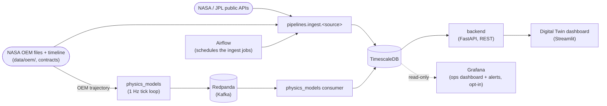

# Architecture

How the Artemis II / Orion digital twin is built: the parts, how data moves between them,
and where each one lives in the repo. This doc describes what exists now; plans and
progress are tracked in GitHub issues.

The project has two data paths that meet in one database, which one backend and one
dashboard read:

- **Real data**: published by NASA/JPL. Batch ingest jobs fetch it into TimescaleDB.
- **Synthetic data**: Orion's telemetry, simulated by the physics models, because
  Orion's onboard telemetry is not public. It is streamed through Kafka (Redpanda) into
  the same database.

See "Real data vs synthetic data" in the root [`README.md`](../README.md) for what each
data set is used for.

## Data flow



Two rules hold everywhere:

- **The dashboard never reads the database.** It talks only to the backend, which returns
  the `contracts` Pydantic models as JSON.
- **`pipelines` and `backend` are independent.** No shared import, and each has its own
  environment-based connection handling (`DATABASE_URL`, or `POSTGRES_*`). This
  duplication is deliberate.

## Components

| Part | Path | Role | Runs as |
|------|------|------|---------|
| Contracts | `packages/contracts/` | ODCS data contracts (`src/odcs/`) and the Pydantic models every other part uses (`contracts.models`), plus the mission timeline (`contracts.planned_attitude`) | library |
| Ingest jobs | `packages/pipelines/` | One self-contained module per real-data source; each owns its table | `python -m pipelines.ingest.<source>`, by hand or from Airflow |
| Scheduler | `airflow/` | `real_data_backfill` (manual, every source) and `real_data_refresh` (daily) DAGs, one task at a time (JPL fair use) | compose profile `airflow` |
| Physics models | `packages/physics_models/` | Simulates Orion's state, thermal, power, comms and radiation at 1 Hz; publishes to Kafka | container `physics_models` |
| Consumer | `packages/physics_models/consumer.py` | Kafka -> TimescaleDB, with upserts | container `physics_models_consumer` |
| Message bus | Redpanda | Kafka-compatible broker | container `redpanda` |
| Database | TimescaleDB (PostgreSQL) | Every table, as hypertables. Host port **5433** | container `timescaledb`, or managed PostgreSQL |
| Migrations | `packages/backend/alembic/` | Schema of the synthetic tables | one-shot container `migrate` |
| Backend | `packages/backend/` | FastAPI REST API, 29 GET endpoints ([endpoints](../packages/backend/README.md)) | container `backend`, port 8000 |
| Dashboard | `dashboard/src/prototype/` | The Digital Twin dashboard, five pages ([dashboard architecture](architecture/DASHBOARD.md)) | container `dashboard`, port 8501 |
| Ops monitoring | `infra/grafana/`, `infra/hostcheck/` | Grafana "Telemetry ops" dashboard and email alerts; a host check for disk, containers and the public site | opt-in compose file; deploy user's crontab |
| Reverse proxy | `infra/caddy/` | HTTPS for the public server | `docker-compose.prod.yml` only |

## Real data path

```
public API or file --> pipelines.ingest.<source> --> TimescaleDB --> backend --> dashboard
```

| Ingest module | Source | Table | Backend route | Daily refresh |
|---------------|--------|-------|---------------|---------------|
| `nasa_oem` | NASA OEM ephemeris files (`data/oem/`) | `oem_state_vectors` | `/oem` | - |
| `mission_events` | Mission timeline (`contracts.planned_attitude`) | `mission_events` | `/mission-events` | - |
| `jpl_orion` | JPL Horizons, Orion (VECTORS) | `orion_ephemeris` | `/orion` | - |
| `jpl_moon` | JPL Horizons, Moon (VECTORS) | `moon_ephemeris` | `/moon` | - |
| `jpl_dsn_geometry` | JPL Horizons, Orion from each DSN site (OBSERVER) | `dsn_site_geometry` | `/dsn-geometry` | - |
| `donki` | NASA DONKI space weather events | `donki_events` | `/donki` | yes |
| `iswa_goes_protons` | GOES proton flux via NASA iSWA HAPI | `goes_integral_protons` | `/iswa-goes-protons` | yes |
| `jpl_cad` | JPL SSD close approaches (CAD) | `close_approaches` | `/close-approaches` | yes |

Each module follows the shape of `jpl_cad.py`: schema DDL, hypertable creation, a
dataclass for parsed records, and `fetch_*` / `upsert_*` / `main()`. Requests to JPL
stay sequential (fair-use policy). The source-specific gotchas (Horizons time scale and
frame, HAPI parameter order and fill values) are in [`CLAUDE.md`](../CLAUDE.md).

## Synthetic data path

```
data/oem/ --> physics_models (tick) --> Kafka topics --> consumer --> TimescaleDB --> backend --> dashboard
```

On every tick (1 Hz; `PHYSICS_MODELS_TIME_SCALE` and `PHYSICS_MODELS_START_MET_SECONDS`
speed up or skip the replay, see
[`RUN_SERVICES.md`](../RUN_SERVICES.md)), `physics_models.runner`:

1. interpolates Orion's state from the NASA OEM arcs (state engine),
2. runs the thermal, power, comms and radiation models, which are coupled with a one-tick
   lag through the cross-model bus,
3. assembles and validates one telemetry packet for the whole tick,
4. publishes everything to Kafka.

Anomaly events and ML features are **placeholders**: the runner emits fixed values so
the topics, tables and routes are exercised, but nothing is detected or learned yet.

| Kafka topic | Message (`contracts.models`) | Table | Backend route (`/telemetry/synthetic/...`) |
|-------------|------------------------------|-------|-----------------------------------------|
| `trajectory` | `SyntheticStateSnapshot` | `state_snapshot` | `/state` |
| `telemetry` | `SyntheticThermalOutput` | `thermal_output` | `/thermal` |
| `telemetry` | `SyntheticPowerOutput` | `power_output` | `/power` |
| `telemetry` | `SyntheticCommsOutput` | `comms_output` | `/comms` |
| `telemetry` | `SyntheticRadiationOutput` | `radiation_output` | `/radiation` |
| `telemetry` | `SyntheticTelemetryPacket` | `telemetry_packet` | `/packet`, `/latest` |
| `cross_model_state` | `SyntheticCrossModelState` | `cross_model_state` | `/cross-model` |
| `events` | `SyntheticAnomalyEvent` (placeholder) | `anomaly_events` | `/anomalies` |
| `ml_features` | `SyntheticMLFeatureVector` (placeholder) | `ml_feature_vectors` | `/ml-features` |

The `telemetry` topic carries five message types. The consumer tells them apart by a
field only that type has (`spacecraft_id` for the packet, checked first). The models
and their coupling are described in
[`architecture/PHYSICS_MODELS.md`](architecture/PHYSICS_MODELS.md).

## Contracts

The five ODCS contracts in `packages/contracts/src/odcs/` (`01_state_engine` to
`05_anomaly_ml_features`) define every synthetic field: name, unit, bounds and quality
rules. The Pydantic models in `contracts.models` follow them, so the same field names run
from the simulator through Kafka, the database columns and the JSON API to the dashboard.
All names are lowercase snake_case. Model-by-model compliance:
[`integration/CONTRACT_COMPLIANCE.md`](integration/CONTRACT_COMPLIANCE.md).

## Design decisions

- **Configuration from the environment.** Database and Kafka settings come from
  environment variables (`.env.example`); the services fail to start without them,
  rather than falling back to a hard-coded default.
- **Two ways a schema is owned.** The synthetic tables are managed by Alembic migrations
  (`migrate` runs before the consumer and backend start). Each real-data table is
  created by its own ingest module.
- **PostgreSQL driver.** SQLAlchemy 2.0 with psycopg 3 (`postgresql+psycopg://`).
- **One dashboard.** The real-data-only Data Explorer was retired
  ([`decisions/ONE_DASHBOARD.md`](decisions/ONE_DASHBOARD.md)).
- **No Spark.** Everything runs on one machine. A cluster would only be adopted for a
  future Monte Carlo layer, and only once a measured limit is hit; see
  [`decisions/SPARK_SCALE_REQUIREMENTS.md`](decisions/SPARK_SCALE_REQUIREMENTS.md).

## Deployment

`docker compose up -d --build` runs the whole app locally. Compose files layered on top:

| File | Adds |
|------|------|
| `docker-compose.yml` | Every service, dev ports; profiles `airflow` and `test` |
| `docker-compose.prod.yml` | Public server: only Caddy publishes ports (HTTPS) |
| `docker-compose.managed-db.yml` | Points every service at an external PostgreSQL and leaves the `timescaledb` container out |
| `docker-compose.grafana.yml` | Read-only Grafana ops dashboard and email alerts |

Start-up order and native runs: [`RUN_SERVICES.md`](../RUN_SERVICES.md). Server runbook:
[`guides/UPCLOUD_DEPLOYMENT.md`](guides/UPCLOUD_DEPLOYMENT.md); its monitoring:
[`guides/MONITORING.md`](guides/MONITORING.md).

## Repository layout

```
telemetry/
├── packages/
│   ├── contracts/        ODCS contracts + Pydantic models + mission timeline
│   ├── pipelines/        real-data ingest jobs (one module per source)
│   ├── physics_models/   simulator, Kafka producer, consumer
│   └── backend/          FastAPI + Alembic migrations
├── dashboard/            Digital Twin dashboard (src/prototype/)
├── airflow/              Airflow image + DAGs for the ingest jobs
├── infra/                Caddy, Grafana, host check
├── data/oem/             NASA OEM ephemeris files
├── tests/                unit/ and integration/, mirroring the source paths
└── docs/                 this documentation (index: docs/README.md)
```
