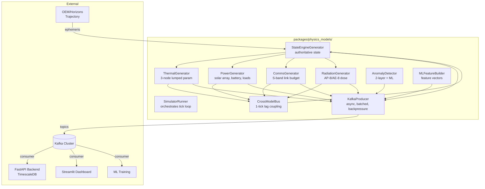
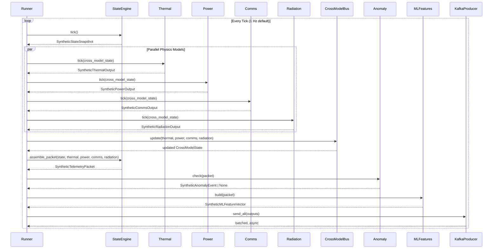

# Physics Models Package — Architecture & Integration

> **Implementation status (2026-10-19):** This document is the *target architecture*.
> Implemented today: StateEngine, Thermal (3-node), Power, CrossModelBus, Kafka producer,
> consumer (`packages/physics_models/consumer.py`, Kafka → TimescaleDB).
> **Not implemented:** Comms, Radiation, Packet Assembler, Anomaly Detector, ML Feature
> Builder — `runner.py` emits hardcoded placeholders for these. `kafka/topics.py` and the
> per-model `generator.py` files shown below do not exist yet; topic strings live in the
> producer/runner. Live topic count is **4** (`trajectory`, `telemetry`,
> `cross_model_state`, `ml_features`); `events` awaits the anomaly detector.

**Package:** `packages/physics_models/`  
**Purpose:** Run physics model generators at tick rate, produce contract-compliant synthetic telemetry, publish to Kafka.  
**Consumers:** FastAPI backend (via Kafka → TimescaleDB), Streamlit dashboard, ML training.

**Authoritative Contracts:** ODCS contracts in `packages/contracts/src/odcs/` — 5 YAML files defining schemas, quality rules, SLAs, and physical bounds for all synthetic data products.

---

## 0. ODCS Contract Authority

**The ODCS contracts in `packages/contracts/src/odcs/` are the single source of truth for all data contracts.**

| ODCS File | Contract Name | Kafka Topic | Description |
|-----------|--------------|-------------|-------------|
| `01_state_engine.odcs.yaml` | `state_engine_snapshot` | `trajectory` | Authoritative spacecraft state from OEM/Horizons/AROW |
| `02_thermal_model.odcs.yaml` | `thermal_model_output` | `telemetry` | 3-node lumped parameter thermal model |
| `03_power_comms_radiation.odcs.yaml` | `power_model_output`, `comms_model_output`, `radiation_model_output` | `telemetry` | Power, S-band comms, radiation dose/degradation |
| `04_cross_model_telemetry_packet.odcs.yaml` | `cross_model_state`, `telemetry_packet` | `cross_model_state`, `telemetry` | Internal coupling bus + synthesised telemetry |
| `05_anomaly_ml_features.odcs.yaml` | `anomaly_events`, `ml_feature_vectors` | `events`, `ml_features` | 3-layer anomaly detection + ML features |

### ODCS Contract Structure (v3.1.0)
Each contract defines:
- **Metadata**: `apiVersion`, `kind: DataContract`, `id`, `name`, `version`, `status`, `domain`
- **Description**: `purpose`, `limitations`, `authoritativeDefinitions` (with source URLs)
- **Team/Ownership**: Data Product Owner, Consumers
- **Servers/Environments**: Kafka topics per environment (production, replay, internal)
- **SLA Properties**: latency, frequency, availability
- **Schema**: Physical topics with fields, each having:
  - `id`, `name`, `businessName`, `logicalType`, `physicalType`
  - `required`, `primaryKey`, `criticalDataElement`
  - **Quality Rules**: `nullValues`, `invalidValues` (with `validValues`), custom text rules
- **Roles/Access**: Read/write permissions per role

### Contract Hierarchy & Dependencies
```
┌─────────────────────────────────────────────────────────────────┐
│                    01_state_engine.odcs.yaml                    │
│  Authoritative state (OEM/Horizons/AROW) → trajectory topic     │
└──────────────────────────┬──────────────────────────────────────┘
                           │ Provides: position, velocity, solar geometry,
                           │ eclipse, DSN visibility, light time
                           ▼
┌──────────────────┬──────────────────┬──────────────────┬──────────────┐
│ 02_thermal_model │ 03_power         │ 03_comms         │ 03_radiation │
│ .odcs.yaml       │ _comms_          │ _model_          │ _model_      │
│                  │ radiation.odcs   │ output           │ output       │
│ 3-node thermal   │ Power + Comms +  │ S-band link      │ AP-8/AE-8    │
│ model            │ Radiation        │ budget           │ dose +       │
└────────┬─────────┴────────┬─────────┴────────┬─────────┴──────┬───────┘
         │                │                  │                │
         └────────────────┴──────────────────┴────────────────┘
                           │ Cross-model coupling (1-tick lag)
                           ▼
              ┌──────────────────────────────┐
              │ 04_cross_model_telemetry_    │
              │ packet.odcs.yaml             │
              │ cross_model_state (internal) │
              │ telemetry_packet (primary)   │
              └──────────────┬───────────────┘
                             │
              ┌──────────────┴───────────────┐
              ▼                              ▼
    ┌────────────────────┐           ┌────────────────────┐
    │ 05_anomaly_ml_     │           │ 05_anomaly_ml_     │
    │ features.odcs.yaml │           │ features.odcs.yaml │
    │ anomaly_events     │           │ ml_feature_vectors │
    │ (Layer 1,2,3)      │           │ (training/infer)   │
    └────────────────────┘           └────────────────────┘
```

### Quality Rule Enforcement
- **Layer 1 (Contract)**: Hard physical impossibilities — reject at ingest
  - `nullValues mustBe: 0` on required fields
  - `invalidValues mustBe: 0` with `validValues` enums
  - Range checks derived from physics (e.g., `0 ≤ battery_soc_pct ≤ 100`)
- **Layer 2 (Physics Rules)**: Valid data, unexpected behaviour
  - Cross-field consistency (e.g., `eclipse_state` vs `eclipse_fraction`)
  - Energy balance residuals
  - Physics-baseline deviations
- **Layer 3 (ML)**: Learned patterns, Isolation Forest / LSTM autoencoder
  - Requires human review before alerting

---

## 1. High-Level Architecture



---

## 2. Tick Loop Data Flow



---

## 3. Package Structure

```
packages/physics_models/
├── pyproject.toml
├── Dockerfile
├── src/
│   └── physics_models/
│       ├── __init__.py
│       ├── config.py                 # Pydantic config for all generators
│       ├── runner.py                 # SimulatorRunner (tick loop orchestrator)
│       ├── kafka/
│       │   ├── __init__.py
│       │   ├── producer.py           # Async batched producer with backpressure
│       │   └── topics.py             # Topic names from ODCS contracts
│       ├── state_engine/
│       │   ├── __init__.py
│       │   ├── generator.py          # StateEngineGenerator
│       │   ├── physics.py            # Orbital mechanics, solar flux, attitude
│       │   └── planned_attitude.py   # Artemis II attitude timeline (107 segments)
│       ├── thermal/
│       │   ├── __init__.py
│       │   ├── generator.py          # ThermalGenerator
│       │   └── physics.py            # 3-node lumped parameter
│       ├── power/
│       │   ├── __init__.py
│       │   ├── generator.py          # PowerGenerator
│       │   └── physics.py            # Solar array, battery, loads
│       ├── comms/
│       │   ├── __init__.py
│       │   ├── generator.py          # CommsGenerator
│       │   └── physics.py            # S-band link budget
│       ├── radiation/
│       │   ├── __init__.py
│       │   ├── generator.py          # RadiationGenerator
│       │   └── physics.py            # AP-8/AE-8, dose accumulation
│       ├── cross_model/
│       │   ├── __init__.py
│       │   └── bus.py                # CrossModelBus (1-tick lag)
│       ├── anomaly/
│       │   ├── __init__.py
│       │   ├── detector.py           # 2-layer (contract + rules) + ML
│       │   └── ml_features.py        # Feature vector builder
│       └── packet/
│           ├── __init__.py
│           └── assembler.py          # TelemetryPacket assembler
├── tests/
│   └── unit/
└── configs/
    └── default.yaml                  # Runtime config (tick_hz, kafka, etc.)
```

---

## 4. Key Interfaces

### 4.1 Generator Protocol

```python
# physics_models/__init__.py
from typing import Protocol
from contracts import (
    SyntheticStateSnapshot,
    SyntheticThermalOutput,
    SyntheticPowerOutput,
    SyntheticCommsOutput,
    SyntheticRadiationOutput,
    SyntheticCrossModelState,
    SyntheticTelemetryPacket,
    SyntheticAnomalyEvent,
    SyntheticMLFeatureVector,
)

class Generator(Protocol):
    """Base protocol for all physics model generators."""
    def tick(self, cross_model_state: SyntheticCrossModelState) -> Any: ...
```

### 4.2 State Engine Generator

```python
# physics_models/state_engine/generator.py
class StateEngineGenerator:
    def __init__(
        self,
        oem_source: OEMSource,           # Horizons ephemeris or OEM file
        planned_attitude: PlannedAttitude, # planned_attitude.py resolver
        config: StateEngineConfig,
    ):
        ...

    def tick(self, cross_model_state: SyntheticCrossModelState) -> SyntheticStateSnapshot:
        """
        1. Interpolate OEM position/velocity at current tick
        2. Resolve planned attitude for current MET (planned_attitude.resolve_attitude)
        3. Compute solar incidence angle, eclipse state, Earth distance, DSN visibility
        4. Return SyntheticStateSnapshot (authoritative per-tick state)
        """
```

### 4.3 Cross-Model Bus (1-Tick Lag)

```python
# physics_models/cross_model/bus.py
@dataclass
class CrossModelBus:
    """Coupling bus — outputs from tick N feed inputs to tick N+1."""
    
    # Thermal → Power
    electronics_bay_temp_k: float = 293.15
    # Power → Thermal
    power_dissipation_w: float = 0.0
    # Radiation → Power
    solar_array_degradation_factor: float = 1.0
    # Radiation → Thermal
    thermal_coating_alpha_factor: float = 1.0
    thermal_coating_eps_factor: float = 1.0
    # Radiation → Comms
    plasma_noise_factor: float = 1.0

    def update(
        self,
        thermal: SyntheticThermalOutput,
        power: SyntheticPowerOutput,
        comms: SyntheticCommsOutput,
        radiation: SyntheticRadiationOutput,
    ) -> None:
        """Called AFTER all physics models complete. Updates lagged state for next tick."""
        self.electronics_bay_temp_k = thermal.temp_electronics_bay_k
        self.power_dissipation_w = power.total_load_w
        self.solar_array_degradation_factor = radiation.solar_array_degradation
        self.thermal_coating_alpha_factor = radiation.thermal_alpha_degradation
        self.thermal_coating_eps_factor = radiation.thermal_eps_degradation
        self.plasma_noise_factor = comms.signal_quality  # proxy for plasma noise
```

**Critical:** Cross-model coupling uses **1-tick lag** to avoid circular dependencies. Models read `cross_model_state` from previous tick.

---

## 5. Kafka Integration

### 5.1 Topic Mapping (from ODCS)

```python
# physics_models/kafka/topics.py
class Topics:
    TRAJECTORY = "trajectory"                    # SyntheticStateSnapshot
    TELEMETRY = "telemetry"                      # SyntheticTelemetryPacket + thermal/power/comms/radiation
    CROSS_MODEL_STATE = "cross_model_state"      # SyntheticCrossModelState
    EVENTS = "events"                            # SyntheticAnomalyEvent
    ML_FEATURES = "ml_features"                  # SyntheticMLFeatureVector
```

### 5.2 Producer Config

```python
# physics_models/kafka/producer.py
from confluent_kafka import Producer
from contracts import (
    SyntheticStateSnapshot,
    SyntheticThermalOutput,
    SyntheticPowerOutput,
    SyntheticCommsOutput,
    SyntheticRadiationOutput,
    SyntheticCrossModelState,
    SyntheticTelemetryPacket,
    SyntheticAnomalyEvent,
    SyntheticMLFeatureVector,
)

class PhysicsModelsKafkaProducer:
    def __init__(self, bootstrap_servers: str):
        self._producer = Producer({
            "bootstrap.servers": bootstrap_servers,
            "linger.ms": 5,                    # batch within tick
            "batch.size": 65536,
            "compression.type": "zstd",
            "max.in.flight.requests.per.connection": 5,
            "acks": "all",
        })

    def send_state(self, msg: SyntheticStateSnapshot) -> None:
        self._produce(Topics.TRAJECTORY, msg.timestamp_utc.isoformat(), msg)

    def send_thermal(self, msg: SyntheticThermalOutput) -> None:
        self._produce(Topics.TELEMETRY, msg.timestamp_utc.isoformat(), msg)

    def send_power(self, msg: SyntheticPowerOutput) -> None:
        self._produce(Topics.TELEMETRY, msg.timestamp_utc.isoformat(), msg)

    def send_comms(self, msg: SyntheticCommsOutput) -> None:
        self._produce(Topics.TELEMETRY, msg.timestamp_utc.isoformat(), msg)

    def send_radiation(self, msg: SyntheticRadiationOutput) -> None:
        self._produce(Topics.TELEMETRY, msg.timestamp_utc.isoformat(), msg)

    def send_cross_model(self, msg: SyntheticCrossModelState) -> None:
        self._produce(Topics.CROSS_MODEL_STATE, msg.timestamp_utc.isoformat(), msg)

    def send_packet(self, msg: SyntheticTelemetryPacket) -> None:
        self._produce(Topics.TELEMETRY, msg.timestamp_utc.isoformat(), msg)

    def send_anomaly(self, msg: SyntheticAnomalyEvent) -> None:
        self._produce(Topics.EVENTS, msg.event_id, msg)

    def send_ml_features(self, msg: SyntheticMLFeatureVector) -> None:
        self._produce(Topics.ML_FEATURES, msg.timestamp_utc.isoformat(), msg)

    def _produce(self, topic: str, key: str, msg: Any) -> None:
        self._producer.produce(
            topic,
            key=key.encode(),
            value=msg.model_dump_json().encode(),
            headers=[("schema_version", b"1")],
        )

    def flush(self, timeout: float = 5.0) -> None:
        self._producer.flush(timeout)
```

---

## 6. Contract Compliance

**Every generator output is a Pydantic model from `contracts`:**

```python
# physics_models/thermal/generator.py
from contracts import SyntheticThermalOutput
from physics_models.cross_model import CrossModelBus

class ThermalGenerator:
    def tick(self, cross_model: CrossModelBus) -> SyntheticThermalOutput:
        # ... compute physics ...
        return SyntheticThermalOutput(
            timestamp_utc=current_tick,
            temp_sun_face_k=...,
            temp_shadow_face_k=...,
            temp_electronics_bay_k=...,
            q_solar_absorbed_w=...,
            q_radiated_w=...,
            q_internal_w=cross_model.power_dissipation_w,  # coupling
            heater_active=...,
            heater_power_w=...,
            thermal_state=...,  # Literal["NOMINAL", "COLD_SURVIVAL", "HOT_LIMIT"]
        )
```

**Guarantees:**
- Schema validation at generation time (fail fast)
- Kafka messages always match contract schema
- FastAPI consumer uses same models → zero serialization mismatch

---

## 7. Configuration

```yaml
# physics_models/configs/default.yaml
tick_hz: 1.0                              # simulation tick rate
kafka:
  bootstrap_servers: "kafka:9092"
  topics:
    trajectory: "trajectory"
    telemetry: "telemetry"
    cross_model_state: "cross_model_state"
    events: "events"
    ml_features: "ml_features"

state_engine:
  oem_source: "horizons"                   # or "oem_file"
  oem_file_path: "/data/orion_artemis2.oem"
  liftoff_utc: "2026-04-01T22:35:00Z"

thermal:
  tick_hz: 1.0

power:
  tick_hz: 1.0

comms:
  tick_hz: 1.0

radiation:
  tick_hz: 1.0

anomaly:
  detection_layer_1_enabled: true         # contract thresholds
  detection_layer_2_enabled: true         # physics rules
  ml_enabled: true                        # ML inference

ml_features:
  tick_hz: 1.0
```

---

## 8. Deployment

```yaml
# docker-compose.yml (add to existing)
services:
  physics_models:
    build:
      context: .
      dockerfile: packages/physics_models/Dockerfile
    environment:
      - KAFKA_BOOTSTRAP_SERVERS=kafka:9092
      - CONFIG_PATH=/configs/default.yaml
    volumes:
      - ./packages/physics_models/configs:/configs:ro
      - ./data/oem:/data/oem:ro
    depends_on:
      kafka:
        condition: service_healthy
    deploy:
      resources:
        limits:
          cpus: '2'
          memory: 2G
```

```dockerfile
# packages/physics_models/Dockerfile
FROM python:3.12-slim

WORKDIR /app

# Install uv
COPY --from=ghcr.io/astral-sh/uv:latest /uv /usr/local/bin/uv

# Copy workspace for contracts dependency
COPY packages/contracts /app/packages/contracts
COPY packages/physics_models /app/packages/physics_models

# Install
RUN uv sync --package physics_models --no-dev

# Copy OEM data
COPY data/oem /data/oem

ENTRYPOINT ["uv", "run", "--package", "physics_models", "python", "-m", "physics_models.runner"]
```

---

## 9. Integration Points

| Component | Interface | Direction |
|-----------|-----------|-----------|
| **OEM/Horizons** | `StateEngineGenerator` reads ephemeris | Input |
| **planned_attitude.py** | `resolve_attitude(MET)` → mode + definition | Input |
| **Kafka** | `PhysicsModelsKafkaProducer` publishes to 4 live topics (`trajectory`, `telemetry`, `cross_model_state`, `ml_features`); `events` planned with AnomalyDetector | Output |
| **FastAPI Backend** | Consumes Kafka → TimescaleDB → `/telemetry/synthetic/*` | Consumer |
| **Streamlit Dashboard** | Same API or direct Kafka consumer | Consumer |
| **ML Training** | Consumes `ml_features` topic | Consumer |

---

## 10. `planned_attitude.py` Integration

The file `packages/pipelines/transforms/planned_attitude.py` (107 verified segments, FD01-FD10) moves to:

```
packages/physics_models/src/physics_models/state_engine/planned_attitude.py
```

**Usage in StateEngineGenerator:**

```python
from physics_models.state_engine.planned_attitude import (
    resolve_attitude,
    get_solar_incidence_angle_estimate,
    get_solar_array_gimbal_estimate,
    AttitudeMode,
)

class StateEngineGenerator:
    def tick(self, cross_model: CrossModelBus) -> SyntheticStateSnapshot:
        met = current_tick - self.liftoff_utc
        attitude_mode, mode_def = resolve_attitude(met)
        
        # Solar angles from attitude
        solar_incidence = get_solar_incidence_angle_estimate(met)
        solar_array_gimbal = get_solar_array_gimbal_estimate(met)
        
        # Eclipse state from orbital geometry
        eclipse_state, eclipse_fraction = compute_eclipse(state_vector)
        
        return SyntheticStateSnapshot(
            timestamp_utc=current_tick,
            x_km=..., y_km=..., z_km=...,
            vx_kms=..., vy_kms=..., vz_kms=...,
            solar_incidence_angle_deg=solar_incidence,
            solar_array_angle_deg=solar_array_gimbal,
            eclipse_state=eclipse_state,
            eclipse_fraction=eclipse_fraction,
            # ... other fields
        )
```

---

## 11. Migration Plan

| Step | Action | Deliverable |
|------|--------|-------------|
| 1 | Create `packages/physics_models/` skeleton | Package structure + pyproject.toml |
| 2 | Move `planned_attitude.py` → `state_engine/` | Attitude resolver available |
| 3 | Port thermal physics from notebooks | `thermal/physics.py` + `generator.py` |
| 4 | Port power physics | `power/physics.py` + `generator.py` |
| 5 | Port comms physics | `comms/physics.py` + `generator.py` |
| 6 | Port radiation physics | `radiation/physics.py` + `generator.py` |
| 7 | Implement CrossModelBus | `cross_model/bus.py` |
| 8 | Implement AnomalyDetector + MLFeatureBuilder | `anomaly/` |
| 9 | Implement Kafka producer | `kafka/producer.py` |
| 10 | Implement SimulatorRunner | `runner.py` |
| 11 | Add to docker-compose, CI | Deployable service |
| 12 | Integration test: Kafka → API → Dashboard | End-to-end verified |

---

## 12. Key Design Principles

| Principle | Implementation |
|-----------|----------------|
| **Contract-first** | Every output is a `contracts` Pydantic model |
| **Single responsibility** | One generator per physics domain |
| **1-tick lag coupling** | CrossModelBus prevents circular deps |
| **Async Kafka** | Non-blocking produce, batched per tick |
| **Config-driven** | YAML config, no hardcoded params |
| **Testable** | Each generator unit-testable with mocked cross_model |
| **Observability** | Structured logging per tick, metrics exported |

---

## 13. Open Questions

1. **Tick rate:** 1 Hz default. Can models support 10 Hz for high-freq comms?
2. **OEM interpolation:** Linear vs. Chebyshev vs. SPICE kernels?
3. **Attitude quaternions:** `planned_attitude.py` gives modes + estimates. Need quaternion resolver for true `roll/pitch/yaw` in StateSnapshot.
4. **ML inference:** Where does the model live? In-process (ONNX) or separate Triton server?
5. **Determinism:** Fixed random seeds for reproducible Monte Carlo runs?

---

## Appendix: Current File Locations to Migrate

| Current Location | Target Location |
|-----------------|-----------------|
| `packages/pipelines/transforms/planned_attitude.py` | `packages/physics_models/state_engine/planned_attitude.py` |
| `notebooks/JPL_Horizons.ipynb` physics cells | `state_engine/physics.py` |
| `notebooks/orion_visualisations_draft.ipynb` thermal/power | `thermal/physics.py`, `power/physics.py` |
| `packages/pipelines/transforms/sgps_proton_flux.py` | `radiation/physics.py` (or keep in pipelines as transform) |