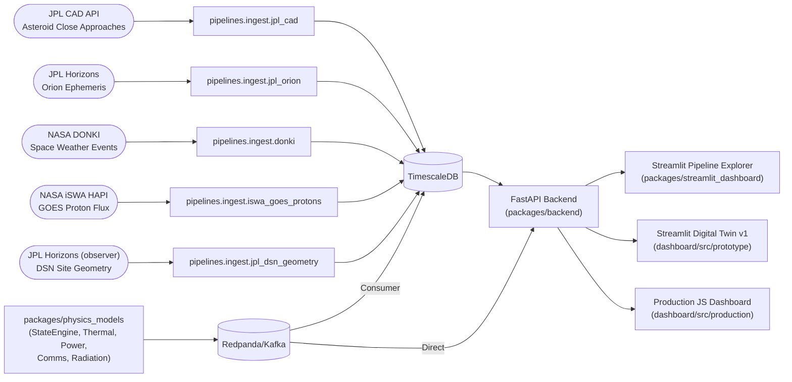

# Telemetry Project — Project Overview & Progress Documentation

**Last Updated:** 2026-10-19  
**Project Root:** `/home/eve/Projects/DataProjects/telemetry`  
**Git Repository:** Yes (active)

---

## 1. Project Overview

### 1.1 Mission Statement
Open-source telemetry project that ingests, processes, and analyzes mission telemetry data in real-time using publicly available NASA flight data. The project builds a **Digital Twin of the Artemis II Orion spacecraft** — combining real JPL/NASA data with physics-based synthetic telemetry generation for mission rehearsal, anomaly detection, and operator training.

### 1.2 MVP Deliverable
**Working end-to-end data pipeline:**
```
Source → Processing → Storage → Dashboard
```

### 1.3 Two Dashboard Tiers
| Tier | Location | Purpose | Technology |
|------|----------|---------|------------|
| **Pipeline Explorer** | `packages/streamlit_dashboard/` | Verify ingestion pipelines, explore raw JPL/NASA data | Streamlit |
| **Digital Twin v1 (Prototype)** | `dashboard/src/prototype/` | Rapid iteration on synthetic telemetry views, validate physics models | Streamlit + Plotly |
| **Production (Future)** | `dashboard/src/production/` | Mission Control grade, real-time, WebSocket-driven | Vanilla JS + Plotly.js |

---

## 2. Current Progress Status (as of 2026-10-19)

### 2.1 ✅ Completed & Verified Working

| Component | Status | Verification |
|-----------|--------|--------------|
| **ODCS Contracts (v3.1.0)** | ✅ Complete | 5 YAML files with lowercase field IDs matching PostgreSQL columns |
| **Pydantic Models** | ✅ Complete | `packages/contracts/src/contracts/models.py` — all synthetic telemetry models |
| **Physics Models Package** | ✅ Core Structure | `packages/physics_models/` — producer, runner, cross-model bus, consumer |
| **Kafka Producer** | ✅ Working | Produces to 4 topics (`trajectory`, `telemetry`, `cross_model_state`, `ml_features`) at 1 Hz; `events` reserved for anomaly detector (not implemented) |
| **Kafka Consumer** | ✅ Working | Consumes → TimescaleDB with upsert logic, demultiplexes telemetry topic |
| **Database Schema (Alembic)** | ✅ Applied | 9 hypertables: `state_snapshot`, `thermal_output`, `power_output`, `comms_output`, `radiation_output`, `telemetry_packet`, `cross_model_state`, `ml_feature_vectors`, `anomaly_events` |
| **Backend API** | ✅ 12 Synthetic Endpoints | `/telemetry/synthetic/*` — all return lowercase JSON keys (25 endpoints total incl. real data + health) |
| **Streamlit Prototype Dashboard** | ✅ 6 Pages | Overview, Trajectory, Thermal, Power, Space Weather, DSN Coverage |
| **Docker Compose Stack** | ✅ Running | `redpanda`, `timescaledb`, `physics_models`, `physics_models_consumer` all healthy |
| **Real Data Pipelines** | ✅ 5 Ingest Modules | JPL CAD, JPL Orion (Horizons), NASA DONKI, GOES Proton Flux (iSWA), JPL DSN Geometry (Horizons observer) |

### 2.2 🔄 Currently Running (Verified Data Flow)

```
Physics Models (1 Hz) → Kafka (Redpanda) → Consumer → TimescaleDB → Backend API (port 8000) → Streamlit Dashboard (port 8501)
```

**Verified Row Counts (sample):**
- `state_snapshot`: 216 rows
- `thermal_output`: 1,142 rows
- `power_output`: 1,142 rows
- `comms_output`: 1,142 rows
- `radiation_output`: 1,188 rows
- `telemetry_packet`: 44 rows
- `cross_model_state`: 1,143 rows
- `ml_feature_vectors`: 1,141 rows

### 2.3 ⚠️ Known Gaps (Not Blocking)

| Gap | Owner | Status |
|-----|-------|--------|
| Comms Generator | Rafaela | Not implemented — placeholder values emitted by runner |
| Radiation Generator | Rafaela | Not implemented — placeholder values emitted by runner |
| Packet Assembler | Rafaela | Not implemented — runner assembles inline |
| Anomaly Detector + ML Features | — | Skeleton only — placeholder values; `events` topic absent |
| WebSocket Endpoints (`/ws/live`, `/ws/events`) | Backend | Not implemented |
| State/Thermal/Power wiring | — | ✅ Done 2026-10-19 (OEM-driven state engine, ThermalModel3Node, PowerModel live) |

> ⚠️ Comms/radiation/packet/ml_features rows above still reflect **placeholder data** from
> `runner.py` — they validate the *pipeline*, not model correctness. Trajectory, thermal and
> power however are real model outputs driven by the NASA OEM arcs since 2026-10-19
> (see `docs/integration/CONTRACT_PHYSICS_AUDIT.md`).

### 2.4 📋 Key Technical Decisions (Locked In)

1. **No hardcoded defaults** — All DB/Kafka config via required env vars (`DATABASE_URL`, `KAFKA_BOOTSTRAP_SERVERS`)
2. **psycopg[binary]** — Correct SQLAlchemy 2.0 + psycopg v3 driver (`postgresql+psycopg://` URL scheme)
3. **Alembic for schema** — Tables managed via migrations, not auto-create
4. **Lowercase everywhere** — Contracts, Pydantic, SQL, JSON all use snake_case lowercase
5. **Consumer demultiplexing** — Single `telemetry` topic → 5 tables via discriminator fields

---

## 3. Technology Stack

### 3.1 Core Technologies

| Layer | Technology | Version | Purpose |
|-------|------------|---------|---------|
| **Language** | Python | 3.12+ | Primary development language |
| **Package Manager** | uv | Latest | Fast Python package/install management |
| **Database** | TimescaleDB | latest-pg16 | PostgreSQL + time-series hypertables (port 5433) |
| **Message Queue** | Redpanda (Kafka) | v24.1.1 | High-throughput event streaming (port 9092) |
| **API Framework** | FastAPI | 0.110+ | REST API backend with automatic OpenAPI docs |
| **Async Server** | Uvicorn | 0.29+ | ASGI server for FastAPI |
| **ORM** | SQLAlchemy | 2.0+ | Database ORM with async support |
| **Dashboard (Proto)** | Streamlit | 1.36+ | Rapid Python dashboard prototyping |
| **Dashboard (Prod)** | Vanilla JS + Plotly.js | — | Production Mission Control UI |
| **Visualization** | Plotly | 5.22+ | Interactive charts in both dashboards |
| **Contracts** | ODCS v3.1.0 + Pydantic | 2.0+ | Data contracts as single source of truth |

### 3.2 Data Science & Physics

| Library | Purpose |
|---------|---------|
| NumPy | Numerical computing |
| Pandas | Data manipulation |
| Astroquery | JPL Horizons / NASA API queries |
| SciPy | Scientific computing (planned for physics models) |

### 3.3 Testing & Quality

| Tool | Purpose |
|------|---------|
| pytest | Unit & integration testing |
| responses | HTTP mocking for unit tests |
| Ruff | Linting & formatting (dev dependency) |

### 3.4 Infrastructure

| Tool | Purpose |
|------|---------|
| Docker / Docker Compose | Container orchestration |
| Alembic | Database migrations |
| Git | Version control |

---

## 4. Architecture

### 4.1 High-Level Data Flow



### 4.2 Physics Models Architecture (Digital Twin Core)

```
┌─────────────────────────────────────────────────────────────────────────────┐
│                        PHYSICS MODELS PACKAGE                               │
│  packages/physics_models/                                                   │
├─────────────────────────────────────────────────────────────────────────────┤
│                                                                             │
│   ┌──────────────┐     ┌──────────────┐     ┌──────────────┐              │
│   │ StateEngine  │────▶│   Thermal    │     │    Power     │              │
│   │ Generator    │     │  Generator   │     │  Generator   │              │
│   │ (Authoritive)│     │  (3-node)    │     │  (Solar/Batt)│              │
│   └──────┬───────┘     └──────┬───────┘     └──────┬───────┘              │
│          │                    │                    │                       │
│          ▼                    ▼                    ▼                       │
│   ┌──────────────────────────────────────────────────────────────┐        │
│   │                   CrossModelBus (1-tick lag)                 │        │
│   │  Thermal→Power: bay_temp    Power→Thermal: load_W           │        │
│   │  Radiation→Power: array_deg  Radiation→Thermal: α/ε_deg    │        │
│   │  Radiation→Comms: plasma_noise                              │        │
│   └──────────────────────────┬──────────────────────────────────┘        │
│                              │                                            │
│                              ▼                                            │
│   ┌──────────────┐     ┌──────────────┐     ┌──────────────┐              │
│   │   Comms      │     │  Radiation   │     │  Anomaly     │              │
│   │  Generator   │     │  Generator   │     │  Detector    │              │
│   │  (S-band)    │     │  (AP-8/AE-8) │     │ (3-layer)    │              │
│   └──────┬───────┘     └──────┬───────┘     └──────┬───────┘              │
│          │                    │                    │                       │
│          └────────────────────┼────────────────────┘                       │
│                               ▼                                            │
│                  ┌────────────────────────┐                                │
│                  │  TelemetryPacket       │                                │
│                  │  Assembler             │                                │
│                  └───────────┬────────────┘                                │
│                              │                                            │
│                              ▼                                            │
│                  ┌────────────────────────┐                                │
│                  │  Kafka Producer        │                                │
│                  │  (4 topics, async,      │                                │
│                  │   batched, zstd)       │                                │
│                  └───────────┬────────────┘                                │
│                              │                                            │
└──────────────────────────────┼────────────────────────────────────────────┘
                               ▼
                    ┌─────────────────────┐
                    │      Kafka          │
                    │   (Redpanda)        │
                    └──────────┬──────────┘
                               │
              ┌────────────────┼────────────────┐
              ▼                ▼                ▼
       ┌──────────┐     ┌──────────┐     ┌──────────┐
       │Consumer  │     │ Backend  │     │  ML      │
       │→Timescale│     │  API     │     │Training  │
       └──────────┘     └──────────┘     └──────────┘
```

### 4.3 Contract Hierarchy (ODCS v3.1.0)

```
┌─────────────────────────────────────────────────────────────────┐
│                    01_state_engine.odcs.yaml                    │
│  Authoritative state (OEM/Horizons/AROW) → trajectory topic     │
└──────────────────────────┬──────────────────────────────────────┘
                           │ Provides: position, velocity, solar geometry,
                           │ eclipse, DSN visibility, light time
                           ▼
┌──────────────────┬──────────────────┬──────────────────┬──────────────┐
│ 02_thermal_model │ 03_power         │ 03_comms         │ 03_radiation │
│ .odcs.yaml       │ _comms_          │ _model_          │ _model_      │
│                  │ radiation.odcs   │ output           │ output       │
│ 3-node thermal   │ Power + Comms +  │ S-band link      │ AP-8/AE-8    │
│ model            │ Radiation        │ budget           │ dose +       │
└────────┬─────────┴────────┬─────────┴────────┬─────────┴──────┬───────┘
         │                │                  │                │
         └────────────────┴──────────────────┴────────────────┘
                           │ Cross-model coupling (1-tick lag)
                           ▼
              ┌──────────────────────────────┐
              │ 04_cross_model_telemetry_    │
              │ packet.odcs.yaml             │
              │ cross_model_state (internal) │
              │ telemetry_packet (primary)   │
              └──────────────┬───────────────┘
                             │
              ┌──────────────┴───────────────┐
              ▼                              ▼
    ┌────────────────────┐           ┌────────────────────┐
    │ 05_anomaly_ml_     │           │ 05_anomaly_ml_     │
    │ features.odcs.yaml │           │ features.odcs.yaml │
    │ anomaly_events     │           │ ml_feature_vectors │
    │ (Layer 1,2,3)      │           │ (training/infer)   │
    └────────────────────┘           └────────────────────┘
```

---

## 5. Data Sources

### 5.1 Real Data (JPL/NASA APIs → Pipelines → TimescaleDB)

| Table | Source | Update Cadence | Key Fields | Dashboard Page |
|-------|--------|----------------|------------|----------------|
| `orion_ephemeris` | JPL Horizons (-1024) | 4 min (OEM), 1s (burns) | x,y,z,vx,vy,vz, range, speed, light_time | Orion Trajectory |
| `close_approaches` | JPL SSD CAD API | Daily batch | des, CA_time, dist, v_rel, h_mag | Close Approaches |
| `donki_events` | NASA DONKI | ~Hourly | CME, SEP, FLR, GST events | Space Weather |
| `goes_integral_protons` | ISWA HAPI (GOES) | 5 min | P1-P500 integral flux (pfu) | Radiation Monitor |
| `dsn_site_geometry` | JPL Horizons (observer) | 4 min | azimuth, elevation, range, visible per DSS | DSN Coverage |

### 5.2 Synthetic Data (Physics Models → Kafka → Backend → TimescaleDB)

| Kafka Topic | Contract | Physics Model | Key Fields | Dashboard Page |
|-------------|----------|---------------|------------|----------------|
| `trajectory` | `SyntheticStateSnapshot` | StateEngine | position, velocity, solar_flux, eclipse, DSN vis | State Engine |
| `telemetry` | `SyntheticThermalOutput` | Thermal (3-node) | T_sun, T_shadow, T_bay, q_solar, q_rad, heater | Thermal |
| `telemetry` | `SyntheticPowerOutput` | Power | array_W, SOC, V, I, net_W, available_W, state | Power |
| `telemetry` | `SyntheticCommsOutput` | Comms (TBD) | EIRP, FSPL, Eb/N0, margin, rate, SQ, state | Comms |
| `telemetry` | `SyntheticRadiationOutput` | Radiation (TBD) | dose_rate, cumulative, degradation_factors, SEP | Radiation |
| `telemetry` | `SyntheticTelemetryPacket` | PacketAssembler | All combined + all_nominal | Overview / Health |
| `cross_model_state` | `SyntheticCrossModelState` | CrossModelBus | coupling variables (1-tick lag) | Coupling Debug |
| `events` | `SyntheticAnomalyEvent` | AnomalyDetector (TBD) | type, layer, severity, field, residual | Anomalies |
| `ml_features` | `SyntheticMLFeatureVector` | MLFeatureBuilder (TBD) | 37 features for ML | ML Debug |

---

## 6. Project Structure

```
telemetry/
├── README.md                         # Project overview & quickstart
├── RUN_SERVICES.md                   # Service startup guide
├── docs/                             # Project documentation (see docs/README.md index)
│   ├── overview/                     # PROJECT_OVERVIEW.md (this file), DATA_SOURCE_ANALYSIS.md
│   ├── architecture/                 # DASHBOARD_ARCHITECTURE.md, PHYSICS_MODELS_ARCHITECTURE.md
│   ├── integration/                  # PIPELINE_STATUS.md, PHYSICS_MODELS_CONTRACT_COMPLIANCE.md, sgps_ge10_proton_flux.md
│   ├── guides/                       # Walkthroughs, prompts, debugging records
│   └── decisions/                    # Design decision records
├── docker-compose.yml                # Infrastructure services
├── pyproject.toml                    # Workspace config (uv)
├── uv.lock                           # Locked dependencies
├── Makefile                          # Common commands
├── .env.example                      # Environment template
│
├── packages/
│   ├── contracts/                    # ODCS contracts + Pydantic models
│   │   ├── pyproject.toml
│   │   └── src/
│   │       └── contracts/
│   │           ├── __init__.py
│   │           └── models.py         # All Pydantic models
│   │       └── odcs/                 # 5 ODCS YAML contracts
│   │
│   ├── pipelines/                    # Real data ingestion pipelines
│   │   ├── pyproject.toml
│   │   └── src/pipelines/
│   │       ├── ingest/               # JPL CAD, Orion, DONKI, GOES
│   │       └── transforms/           # sgps_proton_flux, planned_attitude
│   │
│   ├── physics_models/               # Synthetic telemetry generation
│   │   ├── pyproject.toml
│   │   ├── Dockerfile                # Producer container
│   │   ├── Dockerfile.consumer       # Consumer container
│   │   ├── consumer.py               # Kafka → TimescaleDB (package root)
│   │   ├── configs/
│   │   │   ├── default.yaml
│   │   │   └── docker.yaml
│   │   └── src/physics_models/
│   │       ├── __init__.py
│   │       ├── config.py
│   │       ├── runner.py             # SimulatorRunner (tick loop)
│   │       ├── kafka/
│   │       │   └── producer.py
│   │       ├── state_engine/
│   │       ├── thermal/
│   │       ├── power/
│   │       ├── comms/                # placeholder (not implemented)
│   │       ├── radiation/            # placeholder (not implemented)
│   │       ├── cross_model/
│   │       ├── anomaly/              # placeholder (not implemented)
│   │       └── packet/               # placeholder (not implemented)
│   │
│   ├── backend/                      # FastAPI REST API
│   │   ├── pyproject.toml
│   │   ├── alembic.ini
│   │   ├── alembic/                  # Migrations
│   │   └── src/backend/
│   │       ├── main.py
│   │       ├── models.py             # SQLAlchemy Base + DB models
│   │       ├── api/routes/
│   │       │   ├── synthetic.py      # 12 synthetic endpoints
│   │       │   ├── orion.py          # real data (2 endpoints)
│   │       │   ├── close_approaches.py
│   │       │   ├── donki.py
│   │       │   ├── iswa_goes_protons.py
│   │       │   ├── jpl_dsn_geometry.py
│   │       │   └── health.py
│   │       └── db/
│   │           └── session.py
│   │
│   └── streamlit_dashboard/          # Pipeline Explorer Dashboard
│       ├── pyproject.toml
│       └── src/streamlit_dashboard/
│           ├── app.py
│           ├── data/
│           │   ├── engine.py
│           │   ├── close_approaches.py
│           │   ├── donki.py
│           │   ├── iswa_goes_protons.py
│           │   ├── jpl_dsn_geometry.py
│           │   └── orion.py
│           └── pages/
│               ├── welcome.py
│               ├── close_approaches.py
│               ├── orion.py
│               ├── donki.py
│               ├── iswa_goes_protons.py
│               └── jpl_dsn_geometry.py
│
├── dashboard/
│   └── src/
│       ├── prototype/                # Digital Twin v1 (Streamlit)
│       │   ├── app.py
│       │   ├── data/
│       │   │   └── backend_api.py    # REST client for FastAPI
│       │   └── pages/
│       │       ├── overview.py
│       │       ├── trajectory.py
│       │       ├── thermal.py
│       │       ├── power.py
│       │       ├── space_weather.py
│       │       └── dsn_coverage.py
│       └── replay/                   # Reserved (empty placeholder)
│
├── tests/
│   ├── conftest.py
│   ├── unit/                         # Unit tests (mirror package structure)
│   │   ├── pipelines/
│   │   ├── physics_models/
│   │   └── backend/
│   └── integration/
│       └── test_orion_feature.py
│
├── notebooks/
│   ├── JPL_Horizons.ipynb
│   └── orion_visualisations_draft.ipynb
│
└── docs/                             # (index: docs/README.md)
    ├── README.md                     # Documentation index — start here
    ├── overview/                     # PROJECT_OVERVIEW.md, DATA_SOURCE_ANALYSIS.md
    ├── architecture/                 # DASHBOARD_ARCHITECTURE.md, PHYSICS_MODELS_ARCHITECTURE.md
    ├── integration/                  # PIPELINE_STATUS.md, PHYSICS_MODELS_CONTRACT_COMPLIANCE.md, sgps_ge10_proton_flux.md
    ├── guides/                       # orion-testing-walkthrough.md, PROMPT_PDF_ATTITUDE_PARSING.md, DEBUG_DOCKER_PHYSICS_MODELS.md
    └── decisions/                    # SPARK_SCALE_REQUIREMENTS.md, testing-infrastructure-plan.md

```

---

## 7. Running the Project

### 7.1 Prerequisites
- Docker & Docker Compose
- uv (Python package manager)

### 7.2 Startup Order

```bash
# 1. Infrastructure
docker compose up -d redpanda timescaledb

# 2. Physics Models Producer (generates synthetic telemetry → Kafka)
docker compose up -d --build --force-recreate physics_models

# 3. Consumer (Kafka → TimescaleDB)
docker compose up -d --build --force-recreate physics_models_consumer

# 4. Backend API (host, port 8000)
uv run --package backend python -m backend.main

# 5. Streamlit Prototype Dashboard (host, port 8501)
uv run --package streamlit_dashboard streamlit run dashboard/src/prototype/app.py --server.port 8501 --server.headless true
```

### 7.3 Optional: Ingest Real Data
```bash
uv run --package pipelines python -m pipelines.ingest.jpl_orion
uv run --package pipelines python -m pipelines.ingest.donki
uv run --package pipelines python -m pipelines.ingest.iswa_goes_protons
uv run --package pipelines python -m pipelines.ingest.jpl_dsn_geometry
```

### 7.4 Verification Commands
```bash
# Check Kafka messages
docker exec telemetry-redpanda-1 rpk topic consume trajectory --offset -1 --num 1

# Check DB row counts
docker exec telemetry-timescaledb-1 psql -U telemetry_artemis_2 -d telemetry -c "SELECT count(*) FROM state_snapshot;"

# Test backend endpoints
curl -s "http://localhost:8000/telemetry/synthetic/state?limit=1" | jq .
curl -s "http://localhost:8000/telemetry/synthetic/thermal?limit=1" | jq .
curl -s "http://localhost:8000/health"

# Dashboard health
curl http://localhost:8501/_stcore/health
```

---

## 8. Key Documentation Files

| File | Purpose |
|------|---------|
| `README.md` | Quickstart, architecture diagram, run commands |
| `docs/README.md` | Documentation index — organized by type (overview/architecture/integration/guides/decisions) |
| `docs/overview/PROJECT_OVERVIEW.md` | This file — comprehensive project documentation |
| `docs/integration/PIPELINE_STATUS.md` | End-to-end pipeline verification status |
| `RUN_SERVICES.md` | Service startup & troubleshooting guide |
| `docs/architecture/DASHBOARD_ARCHITECTURE.md` | Dashboard design, pages, API endpoints, implementation phases |
| `docs/architecture/PHYSICS_MODELS_ARCHITECTURE.md` | Physics models package architecture, tick loop, Kafka integration |
| `docs/integration/PHYSICS_MODELS_CONTRACT_COMPLIANCE.md` | Contract compliance verification |


---

## 9. Next Steps (Priority Order)

| Phase | Focus | Deliverable |
|-------|-------|-------------|
| **1 (Current)** | Complete Physics Models | Comms, Radiation, Packet Assembler generators |
| **2** | Anomaly Detection | 3-layer anomaly detector + ML feature builder |
| **3** | WebSocket Support | `/ws/live` (1Hz synthetic), `/ws/events` (anomalies) |
| **4** | Production Dashboard | Vanilla JS + Plotly.js migration from Streamlit |
| **5** | ML Integration | Train/infer on `ml_features` topic |

---

## 10. Contact & Contribution

This is an open-source project under the Data Tribe initiative.

**Contract Authority:** All data contracts defined in `packages/contracts/src/odcs/` (5 ODCS v3.1.0 YAML files) are the single source of truth. Pydantic models in `packages/contracts/src/contracts/models.py` are generated from these contracts and used throughout the codebase for validation at generation, transport, and consumption layers.